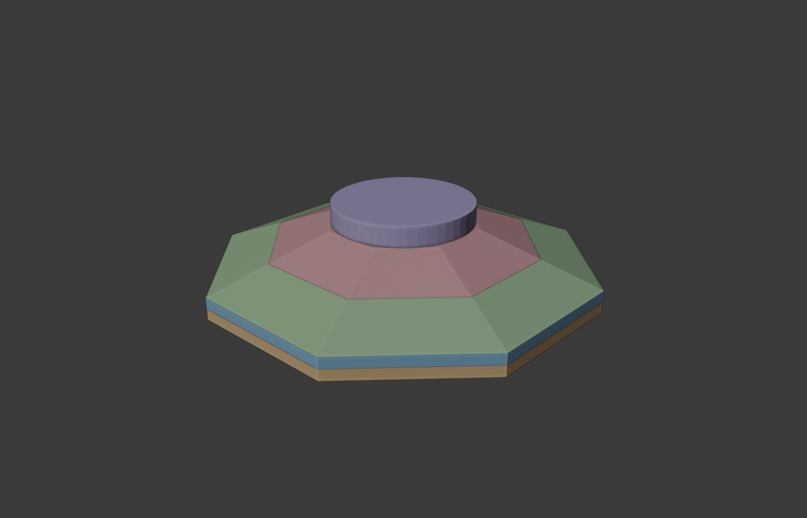
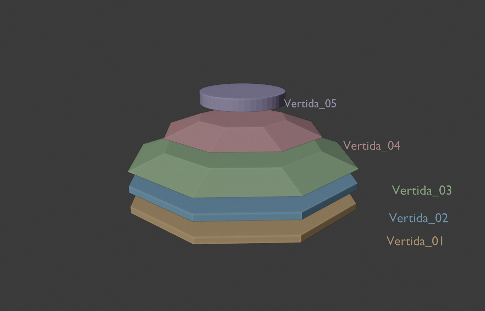
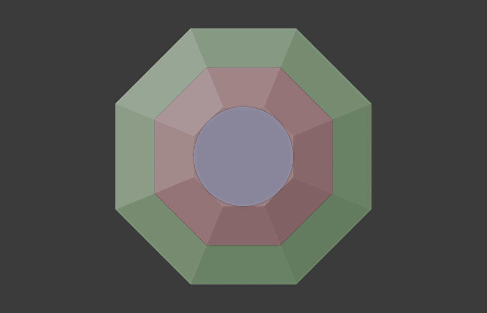
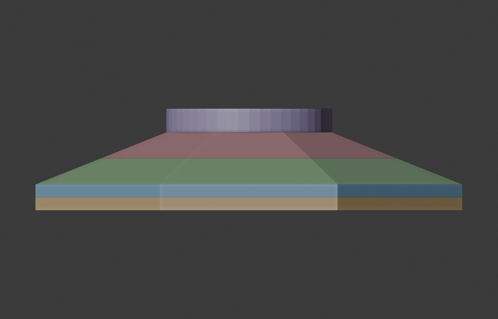

# Proyecto de Hormigón Masivo
# Grupo 4

Planificación de vertidas de una fundación de hormigón masivo (aerogenerador,
caso Ju y Lei 2019) mediante un solver térmico propio, BIM/IFC y clima real.

## Integrantes
- Trinidad Diaz
- Pablo Arancibia
- Eduardo Vergara

## Sitio climático asignado
Litueche, Región de O'Higgins — **lat −34.105457, lon −71.649539**
(coordenada oficial del curso, en [`config/sitio.yaml`](config/sitio.yaml)).

## Registro inicial
E00 — Kickoff y registro de repositorio.
Fecha: 15 de octubre de 2026.

---

## Instalación

Requiere Python 3.11 o superior (probado con 3.12 en Windows 11).

```powershell
# Windows (PowerShell)
py -3.12 -m venv .venv
.venv\Scripts\python -m pip install -r requirements.txt
.venv\Scripts\python -m pip install -e .
```

```bash
# Linux / macOS / cluster
python3 -m venv .venv
.venv/bin/python -m pip install -r requirements.txt
.venv/bin/python -m pip install -e .
```

Luego se activa el entorno (`.venv\Scripts\Activate.ps1` o `source .venv/bin/activate`) o se
llama directo a `.venv\Scripts\mcplan`. Los comandos se corren desde la raíz del repositorio.

## Decisión probabilística (E13 / defensa F02)

```powershell
mcplan clima ensemble                          # ensemble ECMWF (51 miembros) como snapshot nuevo
mcplan estudio --solo-preparar                 # curvas, historias climáticas, cronogramas y sus figuras
mcplan estudio                                 # planes x 8 curvas x 3 historias, en paralelo; retoma lo que falte
mcplan estudio --detalle 5V-e24 M4_22A fría    # una corrida con cortes, vista 3D y VTK
mcplan estudio --sensibilidad 5V-e24 M4_22A fría   # malla, paso de tiempo y profundidad de Tmin
```

Todo se configura en [`config/estudio.yaml`](config/estudio.yaml) y los resultados quedan en `resultados/estudio/`:
`escenarios.csv` (una fila por plan y escenario), `resumen.md`, `resumen_planes.csv`, `definicion.json` y las figuras.
Método y resultados: [docs/decision.md](docs/decision.md).

## Editor sin terminal

Doble clic en **`abrir_editor.bat`** (o `mcplan editor`): se abre en el navegador un formulario para cambiar Δx,
duración, fecha, vertidas, moldaje, aislación y materiales, y simular con un botón. Los resultados aparecen al lado
y cada corrida queda en `resultados/editor/`. No modifica los YAML ni el IFC.

## Uso rápido

```powershell
pytest                                            # 153 tests automatizados (1D/2D/3D, voxelización, solver 3D, bordes, clima, VTK), ~2 min
pytest -m "not lento"                             # la batería rápida (149 tests, ~1 min)
mcplan verificar                                  # solver 1D vs. solución analítica (orden de convergencia)
mcplan sinusoidal --dim 2                         # caso exacto 2D de la guía + orden de convergencia (--dim 3 para 3D)
mcplan fuente --dim 3                             # fuente uniforme en dominio adiabático + balance de energía
mcplan energia --dim 3 --dos-materiales           # conservación de energía (hormigón + suelo, caras adiabáticas)
mcplan rectangulo                                 # ejercicio de la pizarra: 4×2 m a 20 °C, borde a 10 °C -> GIF y T(t)
mcplan rectangulo --hidratacion                   # el mismo rectángulo con calor de hidratación (Tmax, ΔT)
mcplan rectangulo --hidratacion pulso             # con el pulso de la clase Q = Qmax/2·(1 − cos 2πt/T), solución exacta
mcplan bloque                                     # bloque 3×3×0,6 m con el pulso: Dirichlet 20/30 °C, Neumann y Robin
mcplan voxelizar                                  # voxeliza el IFC: vertida_id, volumen vs dx, superficies, activación
mcplan simular3d                                  # fundación 3D por vertidas con hidratación (config/caso_3d.yaml)
mcplan simular3d --dx 0.5 --inicio 2=12 --T-colocacion todas=10 --ocultar 5   # la secuencia es un input
mcplan clima pronostico                           # descarga el pronóstico de Open-Meteo como snapshot nuevo (nunca reemplaza)
mcplan clima info data/clima/snapshots/<archivo>  # metadata del snapshot (fuente, modelo, descarga, horizonte...)
mcplan clima serie                                # serie horaria pronóstico + climatología ERA5 que alimenta los bordes
mcplan simular3d config/caso_14d.yaml --vtk       # caso de 14 días con clima real, moldaje y desmolde (~5 min)
mcplan vtk resultados/caso_14d/vtk --recorte y --interactivo   # PyVista: clipping/slice, núcleo y superficie
mcplan simular1d config/caso_base_1d.yaml         # columna del eje escrita a mano: métricas + gráficos en resultados/
mcplan simular1d config/caso_ifc_1d.yaml          # la misma columna, leída desde el IFC
mcplan malla config/caso_base_1d.yaml             # sensibilidad de Tmax y ΔT al tamaño de celda
mcplan ifc-info geometry/foundation.ifc           # vertidas, property sets y geometría del IFC
```

Para cambiar Δz o Δt sin editar el YAML:

```powershell
mcplan simular1d config/caso_base_1d.yaml --dz 0.1
mcplan simular1d config/caso_base_1d.yaml --dt 1200
mcplan simular1d config/caso_base_1d.yaml --dt 3000            # se rechaza: dt > dt crítico
mcplan simular1d config/caso_base_1d.yaml --dt 3000 --forzar   # se ve la divergencia
```

Los casos 2D/3D aceptan cualquier parámetro (el Δt se calcula solo bajo el paso crítico real):

```powershell
mcplan sinusoidal --dim 3 --L 1 2 1.5 --alpha 2e-4 --A 30 --T0 15 --t 900 --n 8 16
mcplan fuente --dim 2 --q0 2500 --rho 2300 --cp 1000 --T0 10 --t 259200
mcplan sinusoidal --dim 2 --n 20 --dt 9 --forzar                # dt > dt crítico: diverge
```

Detalle del solver 2D/3D, la estabilidad y la batería E05 en [`docs/solver_nd.md`](docs/solver_nd.md).
Dossier de verificación y BIM base (E06): [`docs/dossier_verificacion.md`](docs/dossier_verificacion.md).

**Ejercicio de la pizarra** (`mcplan rectangulo`): rectángulo de 4 × 2 m de hormigón a 20 °C con todo el borde a
10 °C.

- **Sin hidratación:** el Δt crítico es 1746 s (junto al borde), se estabiliza (±0,1 °C) en 20 días y el error
  contra la solución exacta es menor que 0,04 °C.
- **Con hidratación** (`--hidratacion`): el centro llega a 71,9 °C a las 46 h y se estabiliza en 28,7 días. El
  2D con hidratación da lo mismo que el solver 1D.
- **Con el pulso de la clase** (`--hidratacion pulso`, Qmax = 1800 W/m³, T = 42 h): el centro llega a 76,2 °C a las
  38 h. Como Q sólo depende de t, hay solución exacta: el error es menor que 0,2 °C y converge con orden 2.

Detalle en la [sección 7 de `docs/solver_nd.md`](docs/solver_nd.md).

**Bloque 3D** (`mcplan bloque`): 3 × 3 × 0,6 m de hormigón a 20 °C con el pulso de la clase y cuatro bordes.
Los cuatro casos tienen solución exacta (modos cos(μs/l) con μ·tan μ = Bi), y el error es menor que 0,25 °C con
orden 2.

| Borde | Tmax | ΔTmax |
|---|---|---|
| Dirichlet 20 °C | 46,9 °C | 26,5 °C |
| Dirichlet 30 °C | 56,0 °C | 25,7 °C |
| Neumann (adiabático) | 78,5 °C | 0 |
| Robin (β = h/k = 12,5 1/m) | 53,9 °C | 31,1 °C |

Mismo bloque y mismo calor: el borde decide. Detalle en la
[sección 8 de `docs/solver_nd.md`](docs/solver_nd.md).

## Modelo BIM de la fundación

[`geometry/foundation.ifc`](geometry/foundation.ifc) sigue la geometría docente oficial del curso
(guía *Modelar la fundación en Blender + Bonsai*):

| | |
|---|---|
| Bonsai | 0.9.0-post1 |
| Blender | 5.2.2 LTS |
| Esquema IFC | IFC4 |
| Unidades | metros (*New Metric (m) Project*) |
| Clase de cada vertida | `IfcFooting`, atributo `Name` = `Vertida_01` … `Vertida_05` |
| Property set | `UANDES_HormigonMasivo`: VertidaID, Inicio_h, TemperaturaColocacion_C, TipoHormigon, Moldaje, Aislacion, RetiroMoldaje_h |
| Representación | `IfcPolygonalFaceSet` (malla de Bonsai) |

| Vertida | z [m] | Forma | Volumen [m³] |
|---|---|---|---|
| Vertida_01 | 0,00 – 0,55 | prisma octagonal, 18 m entre caras | 147,63 |
| Vertida_02 | 0,55 – 1,10 | prisma octagonal, 18 m entre caras | 147,63 |
| Vertida_03 | 1,10 – 2,20 | tronco octagonal inferior | 214,22 |
| Vertida_04 | 2,20 – 3,30 | tronco octagonal superior (hasta 7 m entre caras) | 88,92 |
| Vertida_05 | 3,30 – 4,30 | pedestal cilíndrico Ø 7 m (48 lados) | 38,37 |

**Simplificaciones geométricas** (detalle en [`geometry/course_geometry.json`](geometry/course_geometry.json)):
planta octagonal regular; espesor 1,10 m en el borde y 3,30 m en el centro, con transición en dos
troncos iguales; pedestal de 1,0 m de altura adoptado sólo para el ejercicio docente; octágonos rotados
22,5° para que sus caras queden alineadas con X e Y; centro en (0, 0) y base en z = 0, sin
georreferenciación. El V5 tiene 38,37 m³ en vez de los 38,48 m³ de un círculo perfecto porque es un
polígono de 48 lados.

| 3D | Explotada |
|---|---|
|  |  |
| **Vista superior** | **Vista lateral** |
|  |  |

**Cómo se generó** (reproducible, desde la raíz del repo):

```powershell
# 1) Modelado en Blender + Bonsai, mismos pasos de la guía (secciones 8 a 17), sin abrir la interfaz
blender -b --python scripts/modelar_fundacion_bonsai.py -- geometry/course_geometry.json geometry/foundation.ifc
# 2) Propiedades del curso (equivale a add_course_properties.py de la guía)
mcplan ifc-propiedades geometry/foundation.ifc
# 3) Capturas de evidencia
blender -b --python scripts/capturas_fundacion_bonsai.py -- geometry/foundation.ifc docs/img
```

**Chequeo desde Python** (`mcplan ifc-info geometry/foundation.ifc`, resumido):

```text
Archivo: geometry/foundation.ifc  (schema IFC4)
- Vertida_01  [IfcFooting]   bbox: 18.00 x 18.00 x 0.55 m, z = 0.00 .. 0.55 m, volumen = 147.63 m3
    UANDES_HormigonMasivo: VertidaID=1, Inicio_h=0.0, TemperaturaColocacion_C=18.0, TipoHormigon=M1, ...
- Vertida_02  [IfcFooting]   bbox: 18.00 x 18.00 x 0.55 m, z = 0.55 .. 1.10 m, volumen = 147.63 m3
- Vertida_03  [IfcFooting]   bbox: 18.00 x 18.00 x 1.10 m, z = 1.10 .. 2.20 m, volumen = 214.22 m3
- Vertida_04  [IfcFooting]   bbox: 12.50 x 12.50 x 1.10 m, z = 2.20 .. 3.30 m, volumen = 88.92 m3
- Vertida_05  [IfcFooting]   bbox:  7.00 x  7.00 x 1.00 m, z = 3.30 .. 4.30 m, volumen = 38.37 m3
GLOBAL  bbox: 18.00 x 18.00 x 4.30 m, volumen total = 636.78 m3
Número de vertidas: 5
```

### Round-trip Bonsai → IFC → Python

```powershell
mcplan ifc-info geometry/foundation.ifc --guardar resultados/ifc_antes.json
# ... abrir geometry/foundation.ifc con File > Open IFC Project, en Object Mode modificar una
#     propiedad (UANDES_HormigonMasivo) o la geometría, y guardar con File > Save IFC Project ...
mcplan ifc-info geometry/foundation.ifc --comparar resultados/ifc_antes.json
mcplan simular1d config/caso_ifc_1d.yaml      # la simulación toma el cambio
git restore geometry/foundation.ifc           # volver al modelo del repositorio
```

## Estructura

```
config/              casos YAML (decisiones y parámetros) y sitio del grupo
geometry/            modelo IFC (Bonsai) y geometría oficial del curso (JSON)
scripts/             modelado y capturas en Blender + Bonsai (sin interfaz), figuras del dossier
src/mcplan/
  solver1d.py        balance de energía por celda, Euler explícito, bordes Dirichlet/Neumann/Robin
  solver_nd.py       el mismo balance en 2D/3D: vóxeles, dos materiales, fuente, hidratación, Δt crítico real
  hidratacion.py     calor de hidratación: curva adiabática Ju y Lei (2019) + edad equivalente
  metricas.py        Tmax y ΔT = Tmax − Tmin(25 mm bajo la superficie)
  caso.py            lectura de casos YAML
  ifc_io.py          lectura/escritura del IFC, propiedades del curso, detección de cambios, columna IFC → solver
  verificacion.py    solución analítica 1D y estudio de convergencia
  verificacion_nd.py casos exactos 2D/3D: sinusoidal, fuente uniforme, energía adiabática
  rectangulo.py      ejercicio de la pizarra: rectángulo con borde Dirichlet, solución exacta, T(t) en puntos
  bloque.py          ejercicio de la pizarra: bloque 3D con el pulso y 4 bordes, solución exacta por modos
  voxelizacion.py    IFC -> grilla: pertenencia por paridad, vertida_id, volumen, superficies, activación
  simulacion3d.py    fundación 3D por etapas: suelo + vertidas que aparecen en su Inicio_h, bordes, hidratación
  bordes.py          condiciones de borde: viento, onda larga, sol (T sol-aire), moldaje/aislación en serie, desmolde
  clima.py           Open-Meteo (pronóstico y ERA5), snapshots inmutables con metadata, serie + climatología
  curvas.py          curvas de hidratación medidas -> fuente por edad (rampa inicial, suavizado, cola)
  planes.py          planes de obra: etapas, esperas, tasa de colocación, D y activación por capas
  estudio.py, informe_estudio.py  decisión: planes x curvas x clima, P_T, P_Δ, P_f, tablas y figuras
  vtk_io.py          exportación VTK (.vti/.pvd) para ParaView y vista con PyVista (slice, clipping)
  vista3d.py         vista 3D con un cuarto cortado (PNG)
  panel.py, panel.html  panel interactivo de cada corrida: Δx, Δt, β de los bordes, vista 3D, cortes y curvas
  servidor.py, editor.html  editor local: formulario que corre `simular3d` y muestra el panel
  graficos.py        figuras (Matplotlib)
  cli.py             comando `mcplan`
tests/               tests automatizados (pytest)
data/clima/          snapshots meteorológicos (JSON tal como llegan de Open-Meteo + metadata) e índice
docs/                modelo 1D, solver 2D/3D (E05), dossier (E06), vertidas (E07), pipeline 3D (E08), línea base (E09),
                     ambiente y clima (E10/E11), simulación de 14 días (E12), decisión (E13/F02)
data/hidratacion/    las 8 curvas de hidratación entregadas por el profesor (source_terms.txt, sin modificar)
```

## Arquitectura

```
Bonsai / Blender  →  IFC  →  IfcOpenShell  →  geometría + propiedades  →  voxelización  →  solver
```

El solver no depende de Blender: sólo lee el archivo `.ifc`.

- **Voxelización 3D** (`voxelizacion.py`, `mcplan voxelizar`): cada celda recibe el `vertida_id` de la vertida que
  contiene su centro, decidido por la paridad de los cruces de un rayo vertical con la malla del IFC. Con dx = 0,05 m
  el error de volumen es de 0,02 % por vertida. Además identifica las superficies exteriores y las juntas entre
  vertidas, y la estructura `PlanVertidas` activa cada vertida en su `Inicio_h` con su temperatura de colocación.
  Diseño y respuestas para E07 en [`docs/modelo_vertidas.md`](docs/modelo_vertidas.md).
- **Simulación 3D por vertidas** (`simulacion3d.py`, `mcplan simular3d`): suelo bajo la base, cada vertida aparece en
  su `Inicio_h` a su temperatura de colocación, Robin en toda cara expuesta (también la cara superior de la última
  vertida colocada) e hidratación con edad equivalente por celda. La secuencia viene del IFC y se puede cambiar en el
  YAML o la línea de comandos. Pipeline y guion de la demo E08 en [`docs/simulacion_3d.md`](docs/simulacion_3d.md);
  línea base E09 en [`docs/baseline_3d.md`](docs/baseline_3d.md).
- **Columna 1D** (`columna_desde_ifc`): el mismo rayo en un solo (x, y). En el eje atraviesa las 5 vertidas (4,30 m);
  cerca del borde, en x = 8,5 m, sólo 1,30 m.

## Estado actual

| Componente | Estado |
|---|---|
| Solver 1D (conducción, multicapa, Dirichlet/Neumann/Robin, hidratación) | ✅ verificado (orden 2 en espacio) |
| Solver 2D/3D (conducción, dos materiales, Dirichlet/Neumann/Robin, fuente volumétrica, hidratación) | ✅ verificado (orden 2 en 2D y 3D; hidratación = 1D) |
| Modelo BIM oficial: 5 vertidas en Bonsai, `UANDES_HormigonMasivo` | ✅ |
| Lectura IFC, detección de cambios, columna IFC → solver por rayo vertical | ✅ |
| Tests automatizados (batería G05/E05 en 1D, 2D y 3D, ejercicios, voxelización, solver 3D, bordes, clima, VTK) | ✅ 153 tests |
| Bloque 3D con pulso y 4 bordes (Dirichlet 20/30, Neumann, Robin), solución exacta | ✅ orden 2 |
| Voxelización del IFC: `vertida_id`, volumen vs dx, superficies exteriores, juntas | ✅ error de volumen 0,02 % con dx = 0,05 m |
| Estructura de activación temporal (`PlanVertidas`: `Inicio_h`, T de colocación, te = 0) | ✅ |
| Solver 3D sobre la grilla voxelizada con activación, suelo e hidratación (`mcplan simular3d`) | ✅ igual a `solver_nd` en una caja y en dos etapas |
| Línea base 3D de la fundación (E09) | ✅ [docs/baseline_3d.md](docs/baseline_3d.md) |
| Condiciones de borde físicas: viento, onda larga al cielo, sol, moldaje/aislación, desmolde | ✅ `bordes.py`, [docs/ambiente_clima.md](docs/ambiente_clima.md) |
| Clima real: Open-Meteo (ECMWF IFS + ERA5), snapshots inmutables, horizonte completado con climatología | ✅ `clima.py`, `data/clima/` |
| Exportación VTK y vista PyVista (slice, clipping, núcleo y superficie) | ✅ `vtk_io.py` |
| Simulación determinista de 14 días (E12) | ✅ [docs/simulacion_14d.md](docs/simulacion_14d.md) |
| Decisión probabilística: 8 curvas x 3 historias (ensemble), P_f conjunta, familia de planes | ✅ `mcplan estudio` |
| HPC | no se usa: enumeración ponderada en paralelo en el computador local |

## Supuestos vigentes

| Supuesto | Valor | Dónde |
|---|---|---|
| Geometría | docente oficial del curso (ver arriba) | `geometry/` |
| Temperatura de colocación e inicio de cada vertida | 18 °C; 0, 6, 12, 18, 24 h | valores iniciales de la guía: decisiones del plan |
| Temperatura ambiente sinusoidal (casos 1D y E08/E09) | media 16 °C, amplitud 7 °C | `caso_base_1d`, `caso_3d` |
| Fecha hipotética de inicio | 27 nov 2026, 08:00 (la defensa final es TBD) | `config/caso_14d.yaml` |
| Clima de la ventana de obra | climatología ERA5 2016–2025 (el pronóstico aún no la cubre) | `data/clima/` |
| Moldaje | terciado 18 mm en V1, V2, V5; desmolde 72 h (pset); sin aislación (pset = TBD) | `config/caso_14d.yaml` |
| Suelo modelado / temperatura | 5 m, 15 °C | `config/*.yaml` |
| Propiedades térmicas y curva adiabática | Ju y Lei (2019) Tabla 2, ec. (2)-(3) | `config/*.yaml`, `hidratacion.py` |
| Todas las vertidas presentes desde t = 0 | sólo en el caso 1D; el 3D activa cada vertida en su `Inicio_h` | `caso.py` |
| Caras laterales con el mismo h que el aire (sin moldaje), sin sol | 27,8 W/(m²K) | `config/caso_3d.yaml` |

## Referencias

- Ju, Y. y Lei, H. (2019). *Actual Temperature Evolution of Thick Raft Concrete Foundations and
  Cracking Risk Analysis*. Advances in Materials Science and Engineering, 7029671.
  https://doi.org/10.1155/2019/7029671
- ICH (2019). *Especificación para Hormigón Masivo Estructural*.
- Guías del curso G00–G08, *Difusión de calor 1D/2D/3D* y *Modelar la fundación en Blender + Bonsai*.
- IfcOpenShell: https://docs.ifcopenshell.org/ · Bonsai: https://docs.bonsaibim.org/
