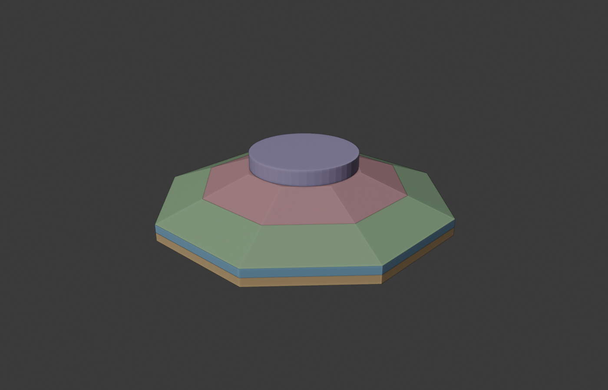
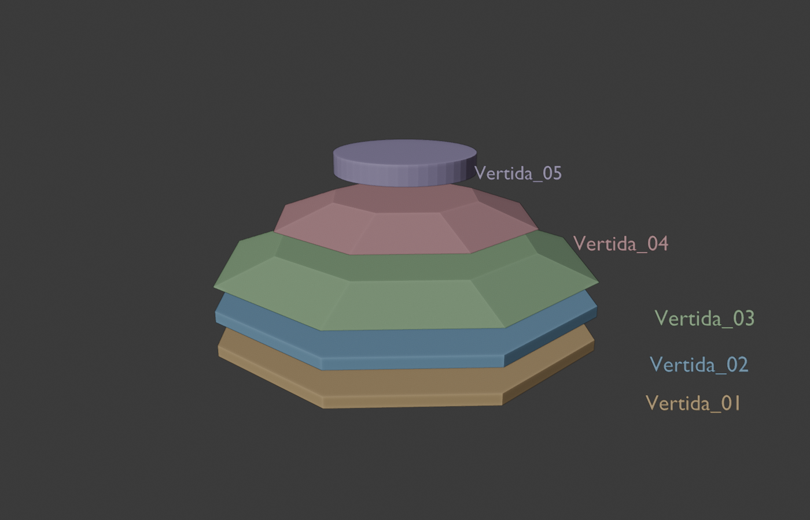
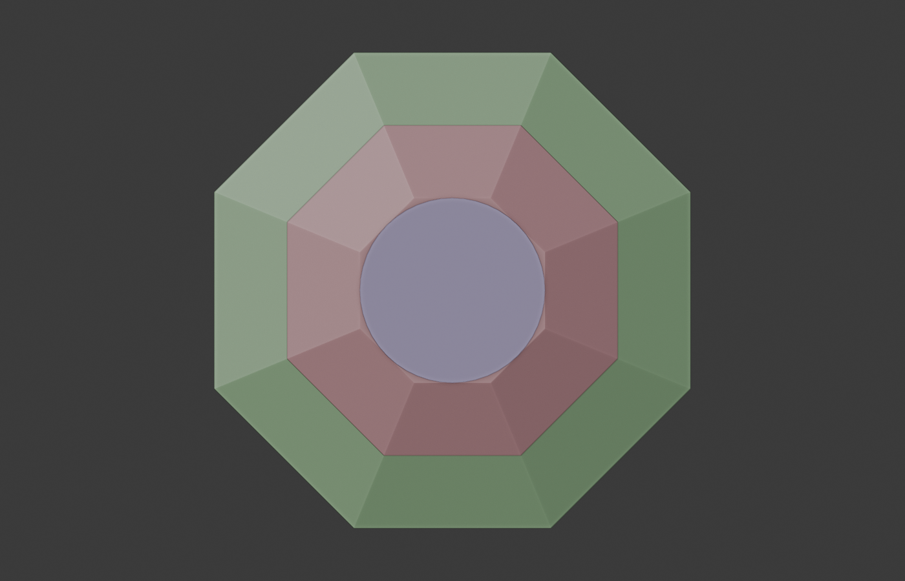
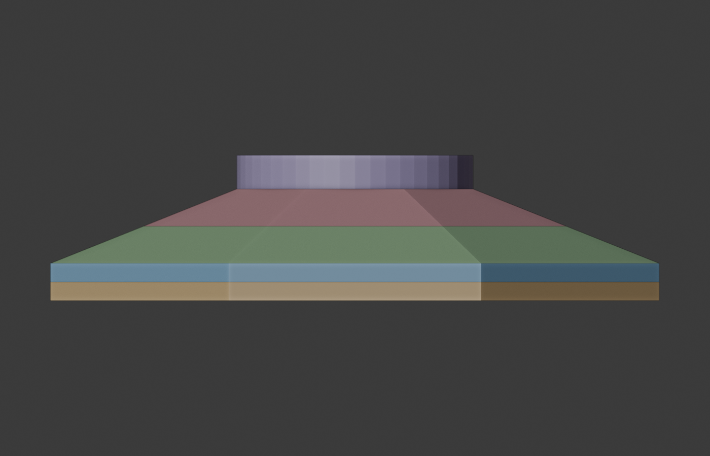

# Proyecto de Hormigón Masivo
# Grupo 4

Planificación de vertidas de una fundación de hormigón masivo (aerogenerador,
caso Ju y Lei 2019) mediante un solver térmico propio, BIM/IFC y clima real.

## Integrantes
- Trinidad Diaz
- Pablo Arancibia
- Eduardo Vergara

## Sitio climático asignado
Litueche, Región de O'Higgins — **lat −34.105457, lon −71.649539**
(coordenada oficial del curso, en [`config/sitio.yaml`](config/sitio.yaml)).

## Registro inicial
E00 — Kickoff y registro de repositorio.
Fecha: 15 de octubre de 2026.

---

## Instalación

Requiere Python 3.11 o superior (probado con 3.12 en Windows 11).

```powershell
# Windows (PowerShell)
py -3.12 -m venv .venv
.venv\Scripts\python -m pip install -r requirements.txt
.venv\Scripts\python -m pip install -e .
```

```bash
# Linux / macOS / cluster
python3 -m venv .venv
.venv/bin/python -m pip install -r requirements.txt
.venv/bin/python -m pip install -e .
```

Luego se activa el entorno (`.venv\Scripts\Activate.ps1` o `source .venv/bin/activate`) o se
llama directo a `.venv\Scripts\mcplan`. Los comandos se corren desde la raíz del repositorio.

## Uso rápido

```powershell
pytest                                            # 36 tests automatizados
mcplan verificar                                  # solver vs. solución analítica (orden de convergencia)
mcplan simular1d config/caso_base_1d.yaml         # columna del eje escrita a mano: métricas + gráficos en resultados/
mcplan simular1d config/caso_ifc_1d.yaml          # la misma columna, leída desde el IFC
mcplan malla config/caso_base_1d.yaml             # sensibilidad de Tmax y ΔT al tamaño de celda
mcplan ifc-info geometry/foundation.ifc           # vertidas, property sets y geometría del IFC
```

Para cambiar Δz o Δt sin editar el YAML:

```powershell
mcplan simular1d config/caso_base_1d.yaml --dz 0.1
mcplan simular1d config/caso_base_1d.yaml --dt 1200
mcplan simular1d config/caso_base_1d.yaml --dt 3000            # se rechaza: dt > dt crítico
mcplan simular1d config/caso_base_1d.yaml --dt 3000 --forzar   # se ve la divergencia
```

## Modelo BIM de la fundación

[`geometry/foundation.ifc`](geometry/foundation.ifc) sigue la geometría docente oficial del curso
(guía *Modelar la fundación en Blender + Bonsai*):

| | |
|---|---|
| Bonsai | 0.9.0-post1 |
| Blender | 5.2.2 LTS |
| Esquema IFC | IFC4 |
| Unidades | metros (*New Metric (m) Project*) |
| Clase de cada vertida | `IfcFooting`, atributo `Name` = `Vertida_01` … `Vertida_05` |
| Property set | `UANDES_HormigonMasivo`: VertidaID, Inicio_h, TemperaturaColocacion_C, TipoHormigon, Moldaje, Aislacion, RetiroMoldaje_h |
| Representación | `IfcPolygonalFaceSet` (malla de Bonsai) |

| Vertida | z [m] | Forma | Volumen [m³] |
|---|---|---|---|
| Vertida_01 | 0,00 – 0,55 | prisma octagonal, 18 m entre caras | 147,63 |
| Vertida_02 | 0,55 – 1,10 | prisma octagonal, 18 m entre caras | 147,63 |
| Vertida_03 | 1,10 – 2,20 | tronco octagonal inferior | 214,22 |
| Vertida_04 | 2,20 – 3,30 | tronco octagonal superior (hasta 7 m entre caras) | 88,92 |
| Vertida_05 | 3,30 – 4,30 | pedestal cilíndrico Ø 7 m (48 lados) | 38,37 |

**Simplificaciones geométricas** (detalle en [`geometry/course_geometry.json`](geometry/course_geometry.json)):
planta octagonal regular; espesor 1,10 m en el borde y 3,30 m en el centro, con transición en dos
troncos iguales; pedestal de 1,0 m de altura adoptado sólo para el ejercicio docente; octágonos rotados
22,5° para que sus caras queden alineadas con X e Y; centro en (0, 0) y base en z = 0, sin
georreferenciación. El V5 tiene 38,37 m³ en vez de los 38,48 m³ de un círculo perfecto porque es un
polígono de 48 lados.

| 3D | Explotada |
|---|---|
|  |  |
| **Vista superior** | **Vista lateral** |
|  |  |

**Cómo se generó** (reproducible, desde la raíz del repo):

```powershell
# 1) Modelado en Blender + Bonsai, mismos pasos de la guía (secciones 8 a 17), sin abrir la interfaz
blender -b --python scripts/modelar_fundacion_bonsai.py -- geometry/course_geometry.json geometry/foundation.ifc
# 2) Propiedades del curso (equivale a add_course_properties.py de la guía)
mcplan ifc-propiedades geometry/foundation.ifc
# 3) Capturas de evidencia
blender -b --python scripts/capturas_fundacion_bonsai.py -- geometry/foundation.ifc docs/img
```

**Chequeo desde Python** (`mcplan ifc-info geometry/foundation.ifc`, resumido):

```text
Archivo: geometry/foundation.ifc  (schema IFC4)
- Vertida_01  [IfcFooting]   bbox: 18.00 x 18.00 x 0.55 m, z = 0.00 .. 0.55 m, volumen = 147.63 m3
    UANDES_HormigonMasivo: VertidaID=1, Inicio_h=0.0, TemperaturaColocacion_C=18.0, TipoHormigon=M1, ...
- Vertida_02  [IfcFooting]   bbox: 18.00 x 18.00 x 0.55 m, z = 0.55 .. 1.10 m, volumen = 147.63 m3
- Vertida_03  [IfcFooting]   bbox: 18.00 x 18.00 x 1.10 m, z = 1.10 .. 2.20 m, volumen = 214.22 m3
- Vertida_04  [IfcFooting]   bbox: 12.50 x 12.50 x 1.10 m, z = 2.20 .. 3.30 m, volumen = 88.92 m3
- Vertida_05  [IfcFooting]   bbox:  7.00 x  7.00 x 1.00 m, z = 3.30 .. 4.30 m, volumen = 38.37 m3
GLOBAL  bbox: 18.00 x 18.00 x 4.30 m, volumen total = 636.78 m3
Número de vertidas: 5
```

### Round-trip Bonsai → IFC → Python

```powershell
mcplan ifc-info geometry/foundation.ifc --guardar resultados/ifc_antes.json
# ... abrir geometry/foundation.ifc con File > Open IFC Project, en Object Mode modificar una
#     propiedad (UANDES_HormigonMasivo) o la geometría, y guardar con File > Save IFC Project ...
mcplan ifc-info geometry/foundation.ifc --comparar resultados/ifc_antes.json
mcplan simular1d config/caso_ifc_1d.yaml      # la simulación toma el cambio
git restore geometry/foundation.ifc           # volver al modelo del repositorio
```

## Estructura

```
config/              casos YAML (decisiones y parámetros) y sitio del grupo
geometry/            modelo IFC (Bonsai) y geometría oficial del curso (JSON)
scripts/             modelado y capturas en Blender + Bonsai (sin interfaz)
src/mcplan/
  solver1d.py        balance de energía por celda, Euler explícito, bordes Dirichlet/Neumann/Robin
  hidratacion.py     calor de hidratación: curva adiabática Ju y Lei (2019) + edad equivalente
  metricas.py        Tmax y ΔT = Tmax − Tmin(25 mm bajo la superficie)
  caso.py            lectura de casos YAML
  ifc_io.py          lectura/escritura del IFC, propiedades del curso, detección de cambios, columna IFC → solver
  verificacion.py    solución analítica y estudio de convergencia
  graficos.py        figuras (Matplotlib)
  cli.py             comando `mcplan`
tests/               tests automatizados (pytest)
docs/                modelo físico-numérico (modelo_1d.md) y capturas del BIM
```

## Arquitectura

```
Bonsai / Blender  →  IFC  →  IfcOpenShell  →  geometría + propiedades  →  voxelización  →  solver
```

El solver no depende de Blender: sólo lee el archivo `.ifc`. En esta versión la "voxelización" es
una columna vertical: un rayo en (x, y) que corta los triángulos de cada vertida
(`columna_desde_ifc`). En el eje atraviesa las 5 vertidas (4,30 m); cerca del borde, en x = 8,5 m,
sólo 1,30 m.

## Estado actual

| Componente | Estado |
|---|---|
| Solver 1D (conducción, multicapa, Dirichlet/Neumann/Robin, hidratación) | ✅ verificado (orden 2 en espacio) |
| Modelo BIM oficial: 5 vertidas en Bonsai, `UANDES_HormigonMasivo` | ✅ |
| Lectura IFC, detección de cambios, columna IFC → solver por rayo vertical | ✅ |
| Tests automatizados (batería de la guía G05 en 1D) | ✅ 36 tests |
| Activación temporal de vertidas (`Inicio_h`) | ⏳ pendiente |
| Clima real (Open-Meteo, snapshots) | ⏳ pendiente: hoy el ambiente es una sinusoide ilustrativa |
| Solver 3D + voxelización | ⏳ pendiente |
| Monte Carlo / HPC / PyVista | ⏳ pendiente |

## Supuestos vigentes

| Supuesto | Valor | Dónde |
|---|---|---|
| Geometría | docente oficial del curso (ver arriba) | `geometry/` |
| Temperatura de colocación e inicio de cada vertida | 18 °C; 0, 6, 12, 18, 24 h | valores iniciales de la guía: decisiones del plan |
| Temperatura ambiente sinusoidal | media 16 °C, amplitud 7 °C | `config/*.yaml` — se reemplaza con Open-Meteo |
| Suelo modelado / temperatura | 5 m, 15 °C | `config/*.yaml` |
| Propiedades térmicas y curva adiabática | Ju y Lei (2019) Tabla 2, ec. (2)-(3) | `config/*.yaml`, `hidratacion.py` |
| Todas las vertidas presentes desde t = 0 | simplificación de la versión 1D | `caso.py` |

## Referencias

- Ju, Y. y Lei, H. (2019). *Actual Temperature Evolution of Thick Raft Concrete Foundations and
  Cracking Risk Analysis*. Advances in Materials Science and Engineering, 7029671.
  https://doi.org/10.1155/2019/7029671
- ICH (2019). *Especificación para Hormigón Masivo Estructural*.
- Guías del curso G00–G08, *Difusión de calor 1D/2D/3D* y *Modelar la fundación en Blender + Bonsai*.
- IfcOpenShell: https://docs.ifcopenshell.org/ · Bonsai: https://docs.bonsaibim.org/
