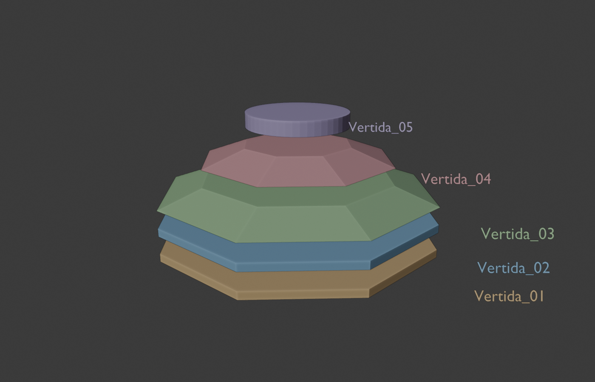
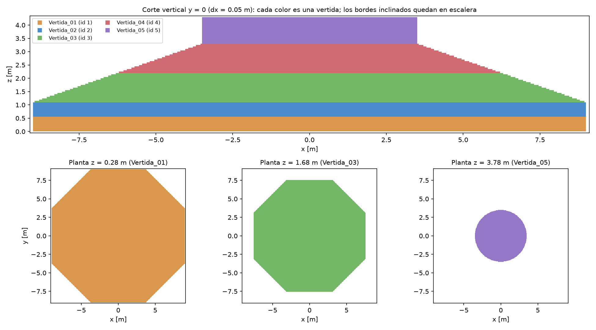
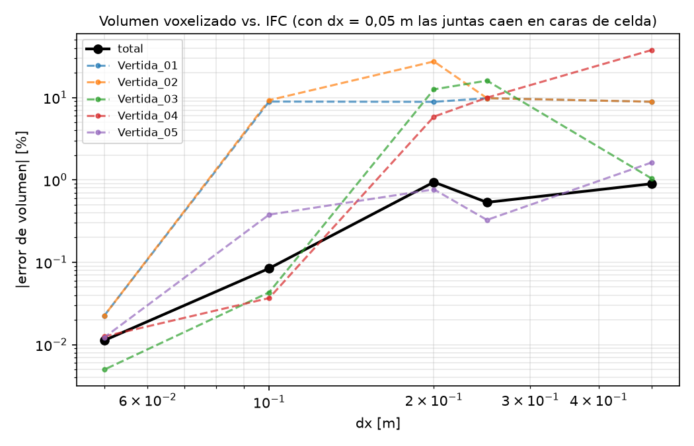
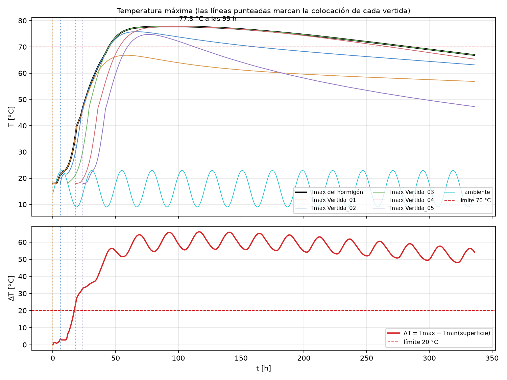
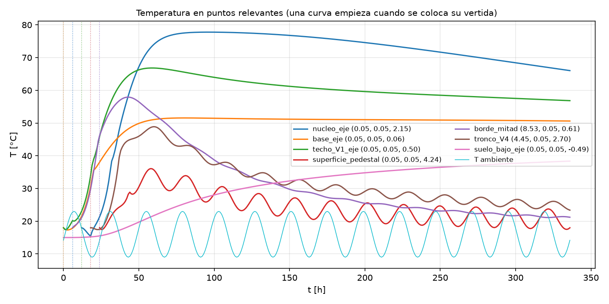
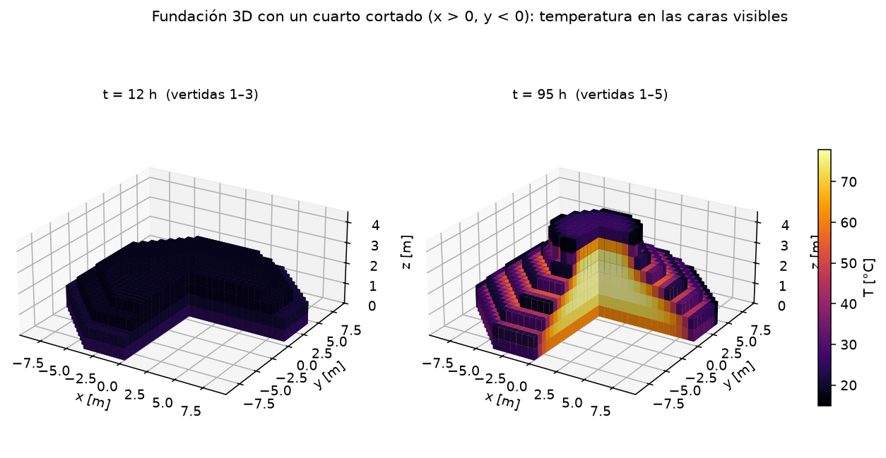
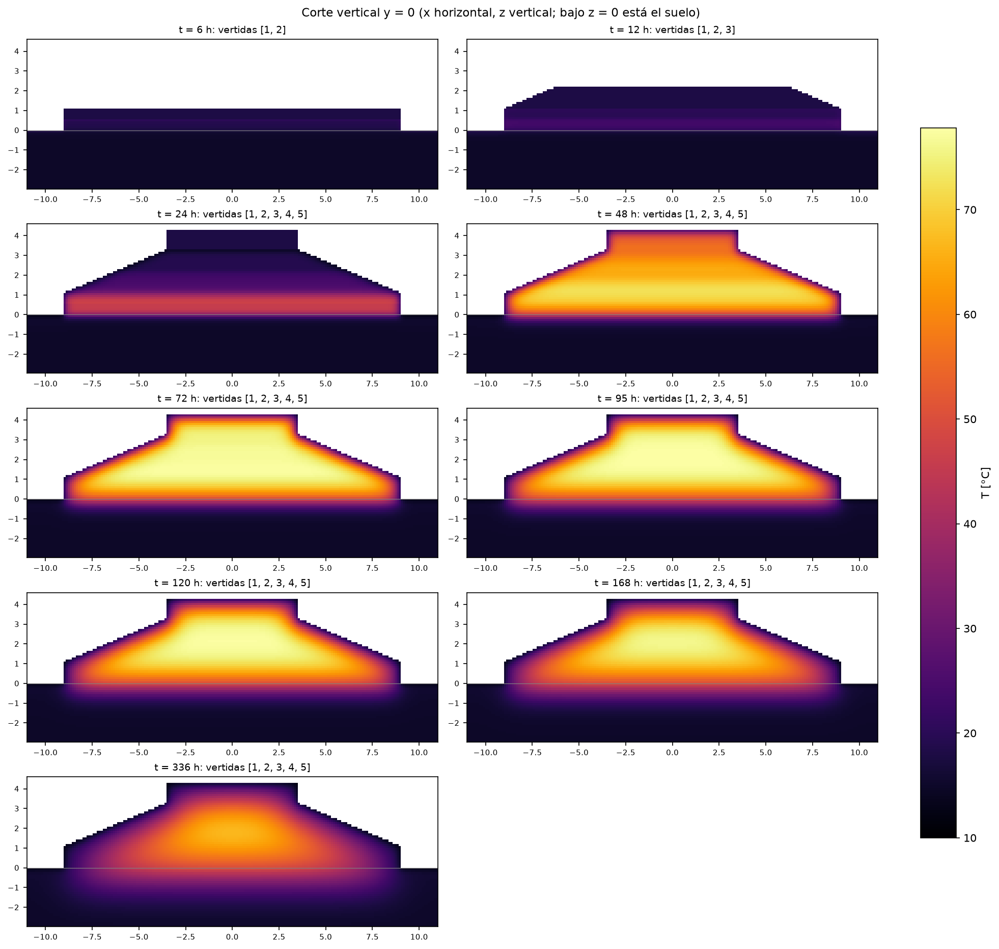
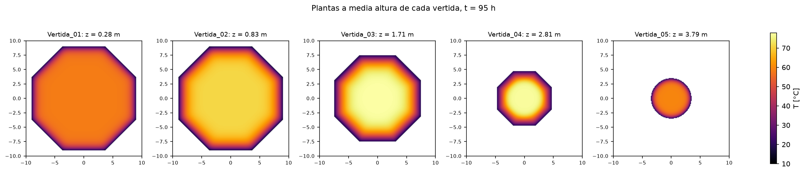

# E09 — Línea base 3D con hidratación (Grupo 4, Litueche)

**Repositorio:** https://github.com/tbdiaz/Proyecto-Hormigon-Masivo · **Commit:** el declarado en Canvas (el que
contiene este archivo).

**Reproducir** (14 días, ~7 min de cálculo):

```powershell
mcplan simular3d config/caso_3d.yaml --dx 0.11 --salida resultados/e09_base --estudio-volumen 0.5 0.275 0.25 0.2 0.1375 0.11 0.1 0.05
```

Salen `serie.csv`, `resumen.json`, las figuras de este informe y `fundacion_3d.html`, una vista 3D interactiva.
Pipeline y verificación: [simulacion_3d.md](simulacion_3d.md).

## 1. BIM y voxelización

Geometría oficial del curso, modelada en Bonsai: un octágono de 18 m, con 3,30 m de fundación y un pedestal de 7 m de
diámetro y 1,00 m de alto, en **5 vertidas** (`IfcFooting`, pset `UANDES_HormigonMasivo`).



IfcOpenShell lee las mallas. Un vóxel pertenece a la vertida que contiene su **centro**, lo que se decide con la
paridad de los cruces de un rayo vertical. Bajo la base se agregan 3 m de suelo y, a los lados, 2 m de margen.



## 2. Error de volumen

| dx [m] | V1 | V2 | V3 | V4 | V5 | total |
|---|---|---|---|---|---|---|
| 0,50 | −8,9 % | −8,9 % | −1,0 % | +37,8 % | +1,6 % | +0,90 % |
| 0,275 | +1,3 % | +1,3 % | −1,4 % | −1,8 % | +8,4 % | +0,38 % |
| 0,25 | −9,8 % | −9,8 % | +16,0 % | −10,0 % | +0,3 % | −0,53 % |
| **0,11** | **+0,04 %** | **+0,04 %** | **+0,21 %** | **+0,29 %** | **−1,11 %** | **+0,06 %** |
| 0,10 | −8,9 % | +9,3 % | −0,04 % | −0,04 % | +0,4 % | +0,08 % |
| 0,05 | −0,02 % | −0,02 % | 0,00 % | −0,01 % | −0,01 % | −0,01 % |

El error total baja al refinar. El error por vertida depende de si dx divide las juntas (0,55 / 1,10 / 2,20 /
3,30 m): si no, una capa entera de celdas cae en la vertida vecina (dx = 0,10). La línea base usa **dx = 0,11 m**:
todas las vertidas bajo 1,1 %, con 2,8 millones de celdas.



**Convergencia del resultado:** con dx = 0,275 m, Tmax = 77,9 °C a las 96 h; con dx = 0,11 m, 77,8 °C a las 95 h.

## 3. Definición de las vertidas

| Vertida | z [m] | V IFC [m³] | Inicio_h | T colocación |
|---|---|---|---|---|
| V1 | 0–0,55 | 147,6 | 0 | 18 °C |
| V2 | 0,55–1,10 | 147,6 | 6 | 18 °C |
| V3 (tronco) | 1,10–2,20 | 214,2 | 12 | 18 °C |
| V4 (tronco) | 2,20–3,30 | 88,9 | 18 | 18 °C |
| V5 (pedestal) | 3,30–4,30 | 38,4 | 24 | 18 °C |

Los valores vienen del **pset del IFC** (cambiables en el YAML o la línea de comandos, sin tocar el solver). Antes de
su `Inicio_h` las celdas de una vertida no existen y la cara superior de la anterior es Robin; al colocarse parten a
18 °C con edad 0 y esa cara pasa a ser junta. Todo se coloca en 24 h, como la Fundación 1 del paper.

## 4. Modelo de hidratación

Se usa la curva adiabática de Ju y Lei (ec. 2):
- $\theta = 0{,}02\,t_e^{2,342}$ hasta $t_e = 21$ h;
- desde ahí, $\theta = 60 - 35\,e^{-0,03(t_e-21)}$.

Fuente: $Q = \rho c_p\,d\theta/dt_e \cdot dt_e/dt$ [W/m³], con edad equivalente de Arrhenius ($E_h/R$ = 2400 K,
$T_0$ = 20 °C) propia de cada celda. Propiedades de la Tabla 2 del paper.

**Condiciones ambientales simplificadas (declaradas):**
- aire a 16 ± 7 °C en una sinusoide diaria, con máximo a las 15 h y colocación a las 8 h;
- h = 27,8 W/m²K en todas las caras expuestas, sin moldaje, aislación, sol ni viento;
- suelo inicialmente a 15 °C, con 15 °C fijos a 3 m de profundidad.

**Numérica:** Euler explícito con $\Delta t$ = 600 s, contra un $\Delta t_{crít}$ de 2113 s; el error temporal en
Tmax es de unos 0,2 °C.

## 5. Resultados



- **Tmax = 77,8 °C a las 95 h** (4,0 días), en el eje a z = 2,04 m, que es el centro del espesor. Supera el límite de
  70 °C durante unas 200 h.
- Cada vertida parte en su línea punteada y se calienta con desfase.
- V1 llega sólo a 66,8 °C, porque pierde calor hacia el suelo.
- El quiebre de las curvas cerca de $t_e$ = 21 h viene del ajuste del paper: allí la derivada de θ es discontinua.



| Punto | Máx. | Instante | A 336 h |
|---|---|---|---|
| Núcleo del eje (z = 2,15) | 77,8 °C | 96 h | 66,0 °C |
| Techo de V1 en el eje (z = 0,45) | 66,8 °C | 59 h | 56,8 °C |
| Base del eje (z = 0,06) | 51,6 °C | 81 h | 50,6 °C |
| Borde (x = 8,5, z = 0,65; 1,30 m de espesor) | 57,9 °C | 43 h | 21,2 °C |
| 5 cm bajo el techo del pedestal | 36,1 °C | 58 h | 18,0 °C |
| Suelo, 0,5 m bajo la base | 38,4 °C | 336 h (sube) | — |

**Cortes 3D:**







Los cortes muestran la fundación creciendo, el núcleo caliente subiendo desde V1–V2 al centro del espesor, un
cascarón frío de ~1 m junto a las caras expuestas y el suelo calentándose bajo la base.

## 6. Comparación cualitativa con Ju y Lei (2019)

| Observación del paper (Fundación 1, sin control) | Modelo | ¿Reproduce? |
|---|---|---|
| Subida rápida tras colocar y después enfriamiento lento: dos fases (acumulación y liberación) | igual | ✅ |
| Máximo en el **núcleo**, ~73 °C a los **~4 días** | 77,8 °C a las 95 h, en el centro del espesor | ✅ forma e instante; +5 °C |
| Subida media de 18 °C/día | 17 °C/día en el núcleo | ✅ |
| Enfriamiento medio de 1 °C/día | 1,2 °C/día (96 → 336 h) | ✅ |
| Sensor superior con el máximo más bajo (~44 °C), que oscila con el ambiente después de ~50 h | 36 °C a las 58 h, oscila desde ~50 h | ✅ forma; más frío |
| La base baja lento después del máximo, porque el suelo conduce poco | la base queda en ~51 °C entre 81 y 336 h | ✅ |
| Temperatura casi igual en puntos de la misma altura (sec. 3.1.3) | uniforme en la zona central; cae a ~1–2 m del borde | ✅ en la zona de los sensores |
| ΔT núcleo–techo de **35 °C**, con su máximo a los 9 días | 54 °C a los 9 días (núcleo − 5 cm bajo el techo) | ❌ |
| 18 días de monitoreo | 14 días simulados | parcial |

**¿Qué reproduce?** Lo **cualitativo**: las dos fases, el núcleo como zona más caliente con máximo cerca del día 4,
los ritmos de subida y bajada, el techo que oscila con el ambiente, la base sostenida por el suelo y la uniformidad
horizontal en la zona central. Aparece sin calibrar nada: el modelo de calor y el balance 3D son coherentes.

**¿Qué todavía no reproduce?** Los **valores absolutos**, que dependen de datos que no tenemos o de simplificaciones
nuestras:
1. **Tmax queda 5 °C más alta.** No se conoce la temperatura de colocación real; usamos 18 °C. Además, la curva θ
   tiende a 60 °C, y después de 168 h es una extrapolación.
2. **El ΔT núcleo–techo es mucho mayor (54 contra 35 °C).**
   - Nuestro techo está desnudo, con h = 27,8 W/m²K hacia un aire de 9–23 °C. En obra hay curado, moldaje y el clima
     del norte de China, y el sensor superior no está a 5 cm de la cara.
   - Con 1,00 m, la altura del pedestal fue adoptada para el ejercicio y no viene del paper.
   - Las caras en escalera sobreestiman el área expuesta de los troncos en ~30 %.
3. **Faltan el clima real** (Open-Meteo), la radiación solar, el moldaje y su retiro, y la aislación.
4. **ΔT se mide distinto:** el modelo usa la celda de superficie (a dx/2 de la cara); el paper usa un sensor a una
   profundidad que desconocemos.

**Próximos pasos:** clima de Litueche, h de moldaje y curado, área real en caras inclinadas y puntos en los
sensores de la Figura 2 del paper.

**Conclusión:** no se busca reproducir los 73 °C. La línea base sí reproduce la física observada, y deja dos
resultados claros: **sin control, la fundación supera ambos criterios** (Tmax > 70 °C y ΔT > 20 °C), igual que la
Fundación 1. En la demo, colocar todo a las 0 h y a 10 °C (`--inicio todas=0 --T-colocacion todas=10`) baja Tmax a
70,1 °C con dx = 0,275 m, sin cambiar el código.
