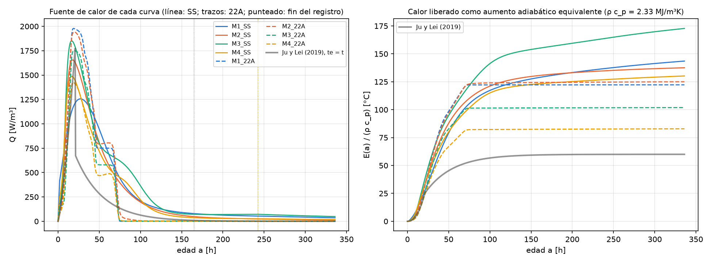
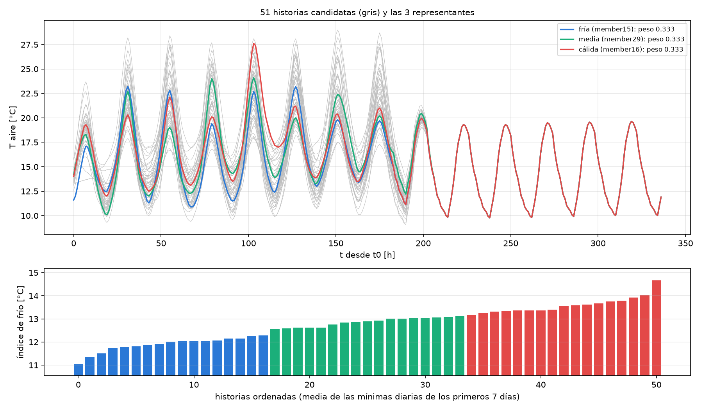
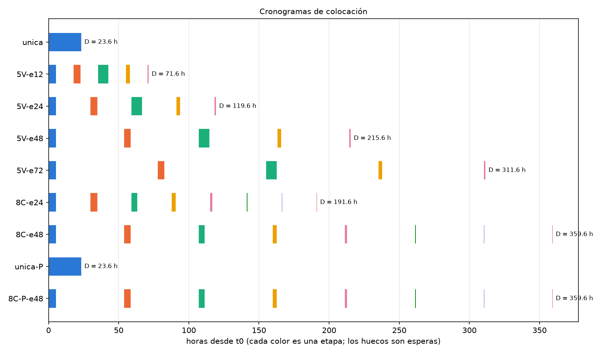
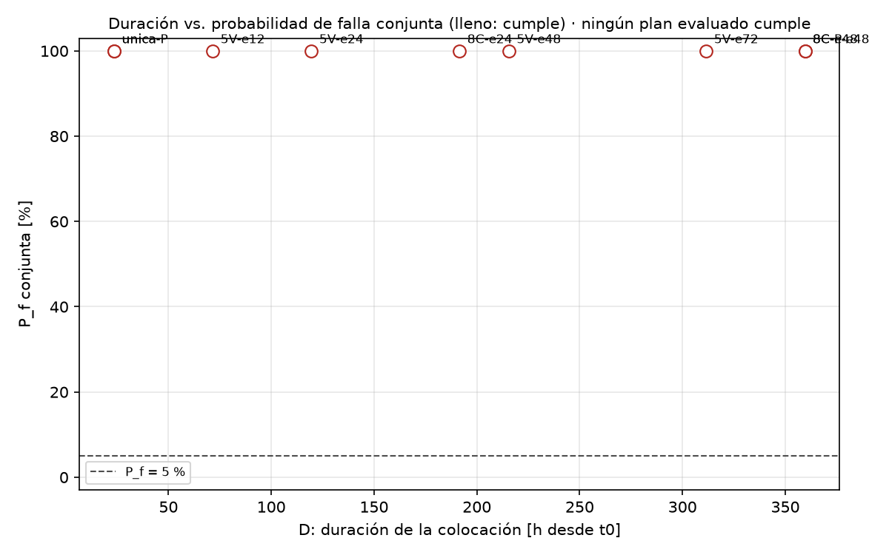
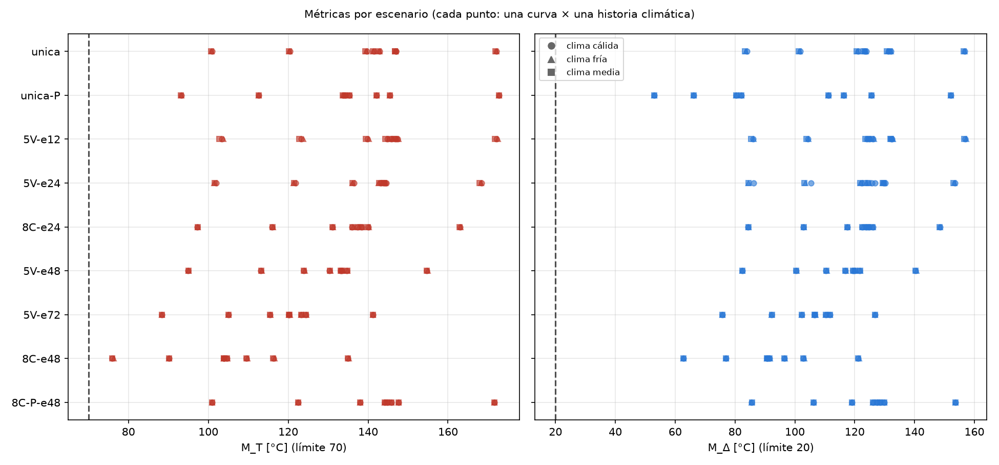
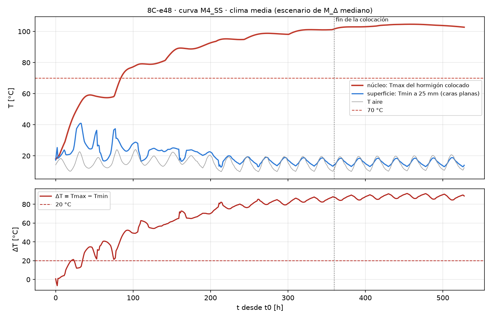
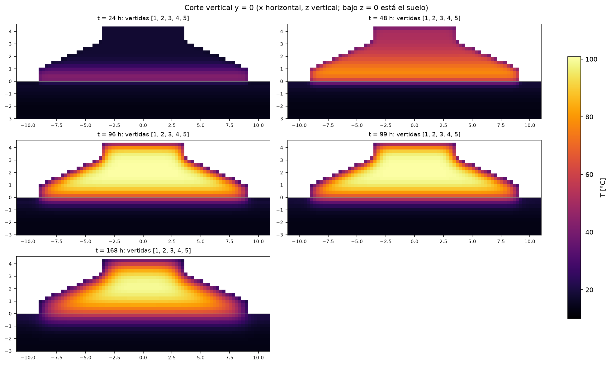

# Decisión probabilística del plan de vertidas (E13 / defensa F02) — Grupo 4, Litueche

**Pregunta.** ¿Cómo colocar todo el hormigón en el menor tiempo posible con
$P_f = P(\{M_T > 70\,°C\} \cup \{M_\Delta > 20\,°C\}) \le 5\,\%$, bajo un modelo de incertidumbre declarado?

**Reproducir** (configuración completa en [`config/estudio.yaml`](../config/estudio.yaml)):

```powershell
mcplan estudio --solo-preparar      # curvas, historias, cronogramas
mcplan estudio                      # 9 planes x 8 curvas x 3 historias = 216 corridas (~45 min, 7 procesos)
mcplan estudio --sensibilidad unica M4_22A fría --dx-variantes 0.275 0.11
mcplan estudio --detalle unica M4_22A fría
```

Resultados: `resultados/estudio/` → `escenarios.csv` (una fila por plan y escenario), `resumen.md`,
`resumen_planes.csv`, `definicion.json` (curvas, pesos, historias, cronogramas y snapshots usados) y las figuras.

## 1. Problema de decisión

- **Inicio común:** $t_0$ = **jueves 19 nov 2026, 08:00, hora de Chile** (America/Santiago, UTC−3), el mismo
  para todos los planes.
- **Objetivo:** minimizar $D(u) = \max_j t_{j,fin} - t_0$. D incluye las esperas y cualquier postergación de la
  primera vertida; el enfriamiento posterior se informa aparte.
- **Recursos, iguales para todos los planes:**
  - una bomba y una cuadrilla, así que las etapas van en serie y sin simultaneidad;
  - tasa de colocación $r$ = **27 m³/h** [supuesto: Ju y Lei vaciaron una fundación igual en ~24 h];
  - duración física de cada etapa $d_j = V_j/r$, con $V_j$ del IFC: el volumen total (637 m³) toma 23,6 h de bomba.
- **Controles en la familia evaluada:**
  - partición (cómo se agrupan o dividen las vertidas del IFC) y esperas entre etapas;
  - T de colocación de 18 °C;
  - moldaje de terciado en V1, V2 y V5, retirado 72 h después de terminar cada vertida (pset `RetiroMoldaje_h`);
  - sin aislación.
- **Colocación por capas.** Ninguna etapa aparece de golpe: sube de abajo hacia arriba a la tasa $r$, y cada capa
  de celdas entra a su T de colocación y con edad 0. Así se respeta la duración física de cada vertida en el
  cronograma y en la física.
- **Planes equivalentes.** Con una sola bomba, todo plan sin esperas es la misma colocación continua: es la
  vertida única, con D = 23,6 h.

## 2. Datos y su procedencia

| Insumo | Fuente | Archivo |
|---|---|---|
| Geometría | IFC oficial del curso (Bonsai), 5 vertidas, voxelizado (error de volumen +0,38 % con dx = 0,275 m; +0,06 % con 0,11 m) | `geometry/foundation.ifc` |
| Hidratación | 8 curvas Q(t) [W/m³] entregadas por el profesor | `data/hidratacion/source_terms.txt` (sin modificar) |
| Clima | Open-Meteo Ensemble API, ECMWF IFS 0,25° ENS (control + 50 miembros), Litueche (−34,105457; −71,649539), punto de grilla (−34,0; −71,75; 337 m), hora local America/Santiago; °C, m/s, W/m², % | `data/clima/snapshots/ensemble_ecmwf_ifs025_20261112T2348Z.json` |
| Continuación del clima y suelo | ERA5 del 12 nov al 24 dic, años 2016–2025 | `data/clima/snapshots/era5_1119_2016-2025_20261112T2348Z.json` |
| Propiedades térmicas | Ju y Lei (2019), Tabla 2: hormigón k = 2,222 W/mK, ρ = 2400 kg/m³, c_p = 970 J/kgK; suelo 1,389 / 1800 / 1273 | `config/caso_14d.yaml` |

### 2.1 Las ocho curvas

Según el encabezado del archivo, las curvas son:
- **Probetas y campañas:** fuente volumétrica $Q(t)$ de cilindros de hormigón (r = 3,75 cm, h = 15 cm),
  probetas M1–M4 en dos campañas (SS: 13–20 abr 2025, 240,5 h; 22A: 22 abr 2025, 163,1 h).
- **Origen:** recuperadas con una PINN a la conductancia β de menor RMSE de cada probeta (7–15 W/m²K).
- **Origen del tiempo:** t = 0 es el inicio del registro + 2 h.

Ya son una fuente $\dot q_h$ en W/m³, así que no se deriva una curva adiabática ni se hace el balance del ensayo.



**Cómo se usan** (`curvas.py`):
- **Edad:** $a = t - t_{activación}$ de cada celda; la edad se reinicia en cada capa colocada.
- **Inicio:** en $0 \le a < 2$ h no hay datos y se usa una rampa lineal hasta $Q(2\,h)$ (< 1 MJ/m³).
- **Suavizado:** promedio por bloques de 10 min. Conserva la energía del registro (test: diferencia < 0,01 %).
- **Cola:** después del registro, exponencial desde el último valor con τ ajustado a las últimas 48 h. Para
  sensibilidad: cero o constante.
- **Temperatura:** sin madurez ni Arrhenius. La fuente queda prescrita por edad; la limitación declarada es que no
  se acelera en el núcleo caliente.
- **Escenarios:** cada escenario usa **una curva completa** para todas las vertidas, es decir, una variación común
  del material.

**¿Son réplicas comparables?**
- **El índice M no ordena las curvas igual en las dos campañas:**
  - por energía, SS va M3 > M1 > M2 > M4, y 22A va M2 > M1 > M3 > M4;
  - por pico, SS va M3 > M2 > M4 > M1, y 22A va M1 > M2 > M3 > M4.
  - Esto es compatible con probetas de una misma mezcla, no con cuatro recetas distintas.
- **Las campañas sí difieren sistemáticamente en la cola:**
  - en SS, la fuente sigue en 24–72 W/m³ a las 240 h;
  - en 22A cae a ~0 cerca de las 72 h, con un escalón brusco que parece un artefacto del ensayo o de la PINN.
- **Hipótesis declarada:** 8 escenarios de material **equiprobables** ($p_m = 1/8$), con sensibilidad a usar
  sólo una campaña.

**Comprobación del calor total.**
- La energía liberada a 14 días va de **193 a 402 MJ/m³**.
- Con ρc_p = 2,33 MJ/m³K, eso equivale a un **aumento adiabático de 83 a 173 °C**. La curva de Ju y Lei da 60 °C
  (140 MJ/m³), y un hormigón con ~400 kg/m³ de cemento libera típicamente 120–170 MJ/m³.
- Con estas curvas, cualquier núcleo grueso supera 70 °C aunque se coloque a 5 °C, y el modelo llega a
  temperaturas sobre 100 °C, que no son físicas en hormigón.
- **Hipótesis de origen:** $Q$ sale de la PINN aproximadamente proporcional a la β estimada, así que un β
  sobreestimado infla la fuente.
- **Consulta prioritaria 1** (sección 9).

### 2.2 Historias climáticas

- **Una historia por miembro:** cada uno de los 51 miembros del ensemble da una historia completa (T, viento,
  radiación y nubosidad del mismo miembro), que conserva el ciclo diario, la persistencia y la coherencia entre
  variables.
- **Continuación:** donde termina el miembro (26 nov), la anomalía decae a la climatología ERA5 en 24 h.
- **Reducción a 3 historias:** se ordenan las 51 por un **índice de frío**, la media de las mínimas diarias de los
  primeros 7 días (las noches frías agrandan el diferencial). Se agrupan en terciles y se elige el miembro
  mediano de cada uno. El peso es la fracción representada: **17/51 = 1/3** cada una.
- **Lo que se pierde:** los extremos dentro de cada tercil (el miembro más frío tiene un índice 1,0 °C bajo el
  representante de su grupo).
- **Independencia:** se asume que material y clima son independientes, así que $w_{mk} = p_m q_k$.



## 3. Modelo continuo

$$\rho c_p \frac{\partial T}{\partial t} = \nabla\cdot(k\nabla T) + \dot q_h(a(\mathbf x, t)) \quad \text{en } \Omega_c(t) \cup \Omega_s$$

| Término | Unidad | Fuente |
|---|---|---|
| ρ, c_p, k del hormigón y del suelo | kg/m³, J/kgK, W/mK | Ju y Lei, Tabla 2 |
| $\dot q_h(a)$ | W/m³ | curva m del escenario, edad $a = t - t_{act}$ |

**Dominio y condiciones iniciales.**
- **Ω_c(t):** el hormigón ya colocado. Cada celda nace a su T de colocación (18 °C) con a = 0.
- **Ω_s:** el suelo, de 3 m de profundidad y 2 m de margen, con su perfil inicial tomado de ERA5.

**Bordes por superficie y por etapa** (normal saliente, Robin $-k\,\partial T/\partial n = U(T - T_{eq})$):

| Superficie | Condición | Detalle |
|---|---|---|
| Hormigón al aire (caras superiores, cara superior de la última capa colocada) | Robin sol-aire | $h_c(v) = 5{,}6 + 4\,v$; onda larga al cielo; $\alpha G$ con α = 0,65 |
| Laterales de V1, V2, V5 con moldaje | Robin + R = 0,15 m²K/W | hasta 72 h después de terminar la vertida |
| Laterales desnudas (troncos; después del desmolde) | Robin | |
| Hormigón–suelo; capa nueva sobre capa anterior | continuidad (conducción, media armónica de k) | sin resistencia de contacto |
| Suelo al aire | Robin sol-aire | |
| Fondo del suelo | Dirichlet: temperatura profunda de ERA5 | |
| Costados del suelo | Neumann q = 0 | |

**Al colocar una capa nueva**, su cara inferior deja de ser borde: la cara superior de la capa anterior pasa de
Robin a continuidad. La nueva cara superior es Robin, y los puntos $S_{25}$ se recalculan con la superficie
existente en ese instante.

## 4. Método numérico y evaluación

- **Discretización:** volúmenes finitos en vóxeles cúbicos con Euler explícito,
  $C_i\,(T_i^{n+1} - T_i^n)/\Delta t = \sum_j G_{ij}(T_j^n - T_i^n) + \sum_{caras} U A (T_{eq} - T_i^n) + \dot q_h V$.
  - Entre vecinas: $G_{ij} = k_{arm} A/\Delta x$.
  - En las caras expuestas: $U = 1/(1/h_{ext} + R + \Delta x/2k)$.
- **Estabilidad:** $\Delta t \le \min(0{,}9\,\Delta t_{crit}, 600\ \text{s})$, con $\Delta t_{crit} = \min_i C_i/\sum G_i$,
  recalculado en cada evento (colocación de una capa o retiro).
- **Métricas:**
  - $M_T$ = máximo sobre Ω_c(t) y t, cada 1 h.
  - $M_\Delta$ = máximo en t de $[\max_{\Omega_c} T - \min_{S_{25}} T]$ en el mismo instante.
  - $S_{25}$: 25 mm bajo cada cara expuesta, con un perfil lineal en la media celda y el flujo de borde, en caras
    planas. Las aristas se informan aparte.
- **Horizonte:** 14 días desde t0, y al menos 7 días después de la última colocación. Las corridas marcan si el
  máximo cae al final.
- **Verificación:**
  - tests contra soluciones exactas 1D/2D/3D (orden 2 en espacio, 1 en tiempo);
  - caja 3D igual a `solver_nd` con moldaje y desmolde;
  - bloque adiabático igual a la curva del ensayo;
  - **balance de energía** en cada corrida: residuo relativo ~1e−15 (`residuo_energia` en `escenarios.csv`).

**Sensibilidad numérica (pendiente: tabla de la sección 7).**

## 5. Probabilidad

$$w_{mk} = p_m\,q_k,\qquad P_f(u) = \sum_{m,k} w_{mk}\,\mathbf 1[F(u,m,k)],\qquad P_T,\ P_\Delta\ \text{marginales}$$

- **Escenarios:** 8 curvas × 3 historias = **24 por plan**. Los mismos escenarios y pesos sirven para todos los
  planes, fijados antes de comparar.
- **Resolución:** cada escenario pesa 1/24 = 4,17 %, así que con 24 escenarios cumple un plan con a lo sumo una
  falla.
- **Doble conteo:** una corrida que excede ambos límites cuenta una sola vez en $P_f$ (hay un test con el ejemplo
  de la pauta).
- **Exactitud:** la enumeración es la probabilidad exacta del modelo discreto (sin error de muestreo). No es una
  probabilidad real certificada.

## 6. Familia de planes y búsqueda

| Familia | Partición | Esperas evaluadas | D [h] |
|---|---|---|---|
| Vertida única | todo el volumen continuo (= cualquier plan sin esperas) | — | 23,6 |
| 5V | las 5 vertidas del IFC | 12, 24, 48, 72 h | 71,6 – 311,6 |
| 8C | 8 capas de ≤ 0,55 m (V3, V4 y V5 partidas en dos) | 24, 48 h | 191,6 – 359,6 |
| Con protecciones (P) | única y 8C-e48, a 10 °C, manta de 5 cm en todas las caras y moldaje 14 días | — / 48 h | 23,6 / 359,6 |

La resolución de la búsqueda es de esperas de 12–24 h. Como ningún plan cumple, no se afirma un óptimo.



## 7. Resultados

Corrida del 12 nov con el ensemble descargado ese día (dx = 0,275 m): 9 planes × 24 escenarios = 216 corridas,
unos 70 s cada una con 7 procesos.

| Plan | D [h] | P_T [%] | P_Δ [%] | P_f conjunta [%] | M_T [°C] (mín–máx) | M_Δ [°C] (mín–máx) | ¿Cumple? |
|---|---|---|---|---|---|---|---|
| Vertida única | 23,6 | 100 | 100 | 100 | 100,7 – 172,1 | 83,4 – 156,7 | no |
| Única + protecciones (10 °C, manta en todo, moldaje 14 d) | 23,6 | 100 | 100 | 100 | 93,2 – 172,8 | 53,0 – 152,1 | no |
| 5V, espera 12 h | 71,6 | 100 | 100 | 100 | 102,8 – 172,5 | 85,3 – 157,3 | no |
| 5V, espera 24 h | 119,6 | 100 | 100 | 100 | 101,5 – 168,5 | 84,4 – 153,5 | no |
| 8C, espera 24 h | 191,6 | 100 | 100 | 100 | 97,2 – 163,1 | 84,4 – 148,6 | no |
| 5V, espera 48 h | 215,6 | 100 | 100 | 100 | 95,0 – 154,9 | 82,4 – 140,6 | no |
| 5V, espera 72 h | 311,6 | 100 | 100 | 100 | 88,4 – 141,3 | 75,8 – 126,8 | no |
| 8C, espera 48 h | 359,6 | 100 | 100 | 100 | **75,9 – 135,2** | **62,7 – 121,5** | no |
| 8C + protecciones, espera 48 h | 359,6 | 100 | 100 | 100 | 101,0 – 171,6 | 85,6 – 153,7 | no |

**No se encontró ningún plan factible.** Las 216 corridas exceden ambos límites, así que
$P_T = P_\Delta = P_f = 100\,\%$ en todos los planes. La sensibilidad a los pesos (sólo SS, sólo 22A, historia fría
con peso 0,5, historias equiprobables) no cambia nada.





**Qué controla el resultado:**
- **La energía de la curva.** Los puntos de cada plan forman 8 grupos, uno por curva. El clima casi no los separa:
  las 3 historias quedan superpuestas.
- **Esperar ayuda poco:**
  - capas delgadas (≤ 0,55 m) con 48 h de espera bajan el M_T más bajo de 101 a 76 °C, pero D sube de 23,6 a
    360 h;
  - aun así, la curva más energética deja el núcleo en 135 °C.
- **Proteger empeora M_T con estas fuentes:** la manta y el moldaje retienen el calor.
  - M_Δ baja al inicio (mínimo 53 °C contra 83 °C de la vertida única).
  - Al retirar la manta, después de los 14 días, aparece un nuevo máximo de M_Δ. Por eso se informan los dos
    horizontes (`M_T_14d`, `M_D_14d` en `escenarios.csv`).
- **Ubicación de los máximos:**
  - M_T ocurre en el centro de la masa (eje, z ≈ 2 m), entre 4 y 7 días después del inicio.
  - M_Δ ocurre de madrugada, con Tmin a 25 mm bajo el escalón horizontal al pie del tronco, en el borde del
    octágono.





**Sensibilidad numérica** (`mcplan estudio --sensibilidad unica M4_22A fría`):

| dx [m] | Δt [s] | profundidad de Tmin | M_T [°C] | M_Δ [°C] | residuo de energía |
|---|---|---|---|---|---|
| 0,275 | 600 | 25 mm | 100,80 | 83,69 | 1,2e−16 |
| **0,110** | 600 | 25 mm | 100,66 | 85,05 | 7,4e−16 |
| 0,275 | **300** | 25 mm | 100,79 | 83,68 | 2,5e−16 |
| 0,275 | 600 | **50 mm** | 100,80 | 82,52 | 1,2e−16 |

- **Malla (0,275 → 0,110 m):** M_T cambia 0,14 °C y M_Δ 1,4 °C.
- **Paso de tiempo:** cambia < 0,02 °C.
- **Profundidad de Tmin (25 → 50 mm):** M_Δ cambia 1,2 °C.
- **Clasificación:** ninguno de estos errores la cambia, porque los márgenes son de 30 a 150 °C. Con 0,11 m se
  resuelve que dx/2 = 55 mm > 25 mm, y la interpolación lineal en la media celda es la aproximación declarada.

**Qué habría que cambiar.** Con estas curvas no basta con esperar ni con proteger. Habría que estudiar:
- **la fuente:** confirmar la energía de las curvas (consulta 1);
- **el calor de la mezcla:** menos cemento o cemento de bajo calor;
- **la temperatura de colocación:** bajarla con hielo o agua fría;
- **el enfriamiento interno:** tuberías.

Ninguna de estas medidas está simulada. No se declaran validadas.

## 8. Qué llevar al taller E13 y a la defensa

| Pedido | Dónde está |
|---|---|
| Repositorio ejecutable y commit identificado | README (instalación); el SHA se declara en Canvas |
| Geometría/IFC, voxelización y corrida completa en una sola vertida | `mcplan voxelizar`; `mcplan estudio --detalle unica M4_22A fría` (cortes, vista 3D, VTK) |
| Las 8 curvas, archivos originales, unidades y antecedentes | `data/hidratacion/source_terms.txt` (encabezado con unidades, β y campañas); `curvas_hidratacion.png`; sección 2.1 |
| Clima descargado: archivo, fuente, modelo, sitio, fechas, zona horaria, unidades, cobertura | `mcplan clima listar`; `mcplan clima info data/clima/snapshots/ensemble_...json`; `definicion.json` |
| Propuesta de vertidas, parámetros, bordes y resultados preliminares | `config/estudio.yaml`, `config/caso_14d.yaml`, `resultados/estudio/resumen.md` |
| Evidencia de verificación | `pytest` (153 tests); balance de energía por corrida; sensibilidad de malla, Δt y profundidad (sección 7) |
| Una fila por plan y escenario con pesos, M_T, M_Δ, I_T, I_Δ, I_F, instante y ubicación | `resultados/estudio/escenarios.csv` |
| Tabla P_T, P_Δ, P_f y "¿cumple?" por plan; D vs P_f; cronogramas | `resumen.md`, `resumen_planes.csv`, `D_vs_Pf.png`, `cronogramas.png` |
| Curvas núcleo/superficie, corte con instante y escala de colores | `nucleo_superficie_<plan>.png`; `detalle_*/cortes_y0.png`, `vista_3d.png` |
| Sensibilidad a los pesos | `resumen.md`: sólo una campaña, historia fría con peso 0,5, historias equiprobables |

**Antes de la defensa (17–18 nov):**
1. `mcplan clima ensemble`, para que el ensemble cubra hasta ~2 dic.
2. `mcplan estudio`, con el clima congelado en ese snapshot.
3. Declarar el SHA.

## 9. Consultas prioritarias para el taller E13

1. **Energía de las curvas.** Las 8 curvas liberan 193–402 MJ/m³ a 14 días, lo que equivale a 83–173 °C
   adiabáticos con ρc_p = 2,33 MJ/m³K. Con ellas ningún plan baja de 70 °C y el núcleo pasa de 100 °C.
   - ¿Son W/m³ de hormigón como el de la fundación?
   - ¿Qué ρc_p y qué β tenía cada probeta?
   - ¿Hay que reescalarlas a la dosificación de la obra?
2. **Significado de M1–M4 y SS/22A.** ¿Son 4 probetas de una misma mezcla (réplicas) o 4 mezclas? Si son mezclas,
   la mezcla es una decisión y sólo quedan 2 réplicas por mezcla. ¿Qué pasó cerca de las 72 h en la campaña 22A,
   donde la fuente cae a cero?
3. **Recursos y controles admitidos.**
   - ¿Hay una tasa de colocación o una capacidad de planta definida por el curso? (supuesta: 27 m³/h)
   - ¿Se admiten enfriamiento con hielo o agua fría, aislación completa o tuberías de enfriamiento como
     controles del plan?
