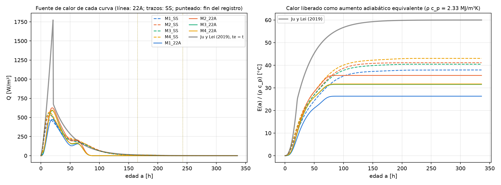
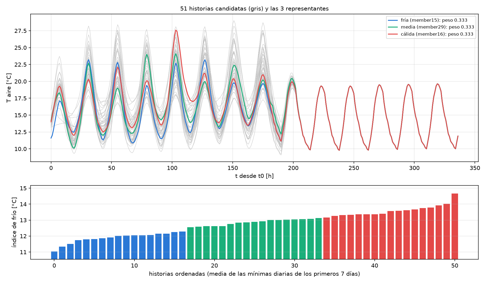
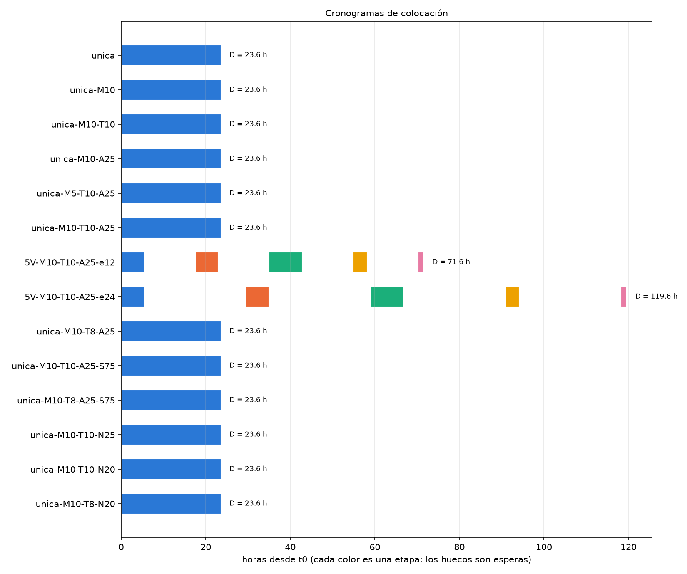
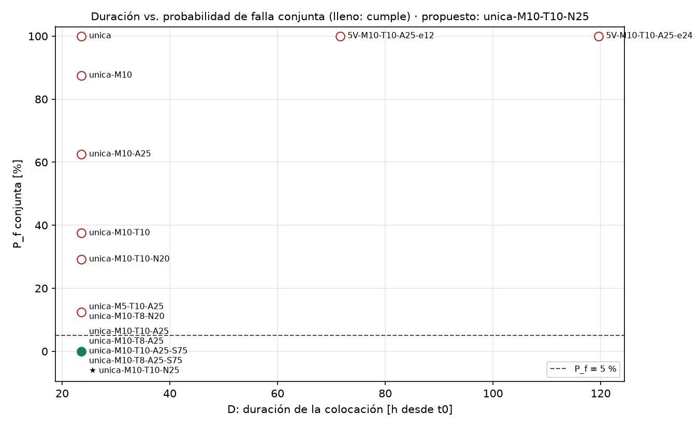
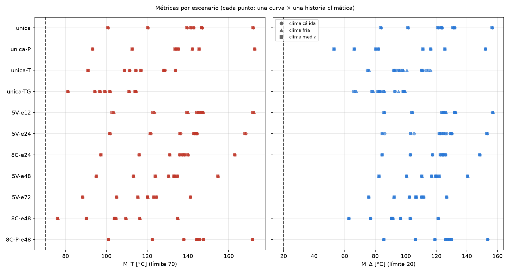
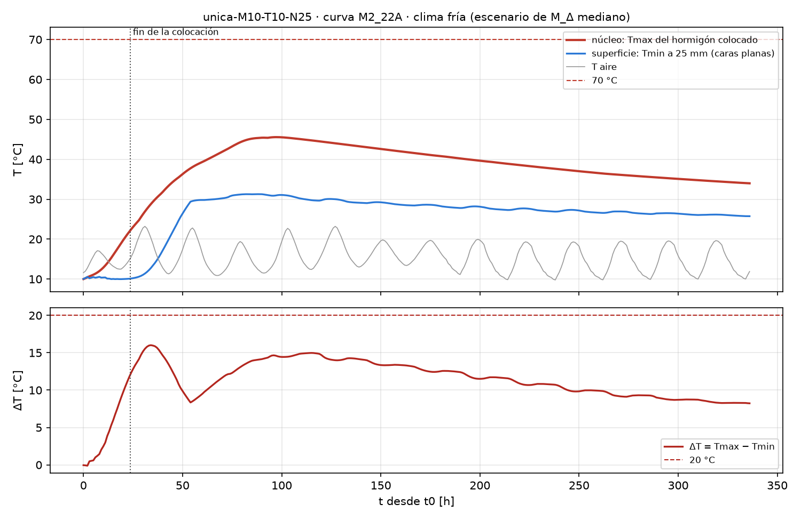
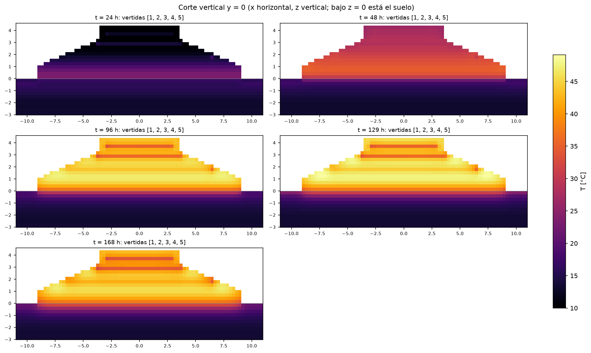

# Decisión probabilística del plan de vertidas (E13 / defensa F02) — Grupo 4, Litueche

> **Informe final (16 nov 2026):** el Plan de Control de Temperatura está en
> [docs/informe_final/](informe_final/). Usa el clima real de 2025 (30 temporadas ERA5) en vez del pronóstico de
> este documento.
>
> - **Confirma la propuesta** `unica-M10-T10-N25`.
> - **Ajusta la colocación:** máximo 10 °C a la descarga y meta de 8 °C en planta. Colocando a 12 °C, la malla fina
>   supera los 20 °C.
> - **Corrige la malla:** suma +1,1 °C a todas las M_Δ.
> - **Retiro de las protecciones:** gradual y condicionado a los sensores, desde el día 26.
>
> Este documento queda como registro del estudio con el pronóstico para la fecha de la defensa.

**Pregunta.** ¿Cómo colocar todo el hormigón en el menor tiempo posible con
$P_f = P(\{M_T > 70\,°C\} \cup \{M_\Delta > 20\,°C\}) \le 5\,\%$, bajo un modelo de incertidumbre declarado?

**Reproducir** (configuración completa en [`config/estudio.yaml`](../config/estudio.yaml)):

```powershell
mcplan estudio --solo-preparar      # curvas, historias, cronogramas
mcplan estudio                      # 14 planes x 8 curvas x 3 historias = 336 corridas (~50 min, 7 procesos)
mcplan estudio --sensibilidad unica-M10-T10-N25 M4_SS media --dx-variantes 0.275 0.11   # confirmación (~7 min)
mcplan estudio --detalle unica-M10-T10-N25 M4_SS media                                   # cortes, vista 3D, VTK
```

Resultados: `resultados/estudio/` → `escenarios.csv` (una fila por plan y escenario), `resumen.md`,
`resumen_planes.csv`, `definicion.json` (curvas, pesos, historias, cronogramas y snapshots usados) y las figuras.

## 1. Problema de decisión

- **Inicio común:** $t_0$ = **jueves 19 nov 2026, 08:00, hora de Chile** (America/Santiago, UTC−3), el mismo
  para todos los planes.
- **Objetivo:** minimizar $D(u) = \max_j t_{j,fin} - t_0$. D incluye las esperas y cualquier postergación de la
  primera vertida; el enfriamiento posterior se informa aparte.
- **Recursos, iguales para todos los planes:**
  - una bomba y una cuadrilla, así que las etapas van en serie y sin simultaneidad;
  - tasa de colocación $r$ = **27 m³/h** [supuesto: Ju y Lei vaciaron una fundación igual en ~24 h];
  - duración física de cada etapa $d_j = V_j/r$, con $V_j$ del IFC: el volumen total (637 m³) toma 23,6 h de bomba.
- **Controles en la familia evaluada** (sección 6):
  - partición (cómo se agrupan o dividen las vertidas del IFC) y esperas entre etapas;
  - T de colocación de 18 °C (guía del curso), o 10 u 8 °C con hormigón preenfriado;
  - moldaje de terciado en V1, V2 y V5, retirado 72 h después de terminar cada vertida (pset `RetiroMoldaje_h`) o,
    con protección, junto con la manta;
  - manta de aislación de 5 o 10 cm en todas las caras expuestas;
  - tubos de enfriamiento HDPE con agua tibia, en todas las vertidas o sólo en el núcleo.
- **Colocación por capas.** Ninguna etapa aparece de golpe: sube de abajo hacia arriba a la tasa $r$, y cada capa
  de celdas entra a su T de colocación y con edad 0. Así se respeta la duración física de cada vertida en el
  cronograma y en la física.
- **Planes equivalentes.** Con una sola bomba, todo plan sin esperas es la misma colocación continua: es la
  vertida única, con D = 23,6 h.

## 2. Datos y su procedencia

| Insumo | Fuente | Archivo |
|---|---|---|
| Geometría | IFC oficial del curso (Bonsai), 5 vertidas, voxelizado (error de volumen +0,38 % con dx = 0,275 m; +0,06 % con 0,11 m) | `geometry/foundation.ifc` |
| Hidratación | 8 curvas Q(t) [W/m³] entregadas por el profesor, versión corregida del 14 nov 2026 | `data/hidratacion/source_terms.txt` (sin modificar) |
| Clima | Open-Meteo Ensemble API, ECMWF IFS 0,25° ENS (control + 50 miembros), Litueche (−34,105457; −71,649539), punto de grilla (−34,0; −71,75; 337 m), hora local America/Santiago; °C, m/s, W/m², % | `data/clima/snapshots/ensemble_ecmwf_ifs025_20261112T2348Z.json` |
| Continuación del clima y suelo | ERA5 del 12 nov al 24 dic, años 2016–2025 | `data/clima/snapshots/era5_1119_2016-2025_20261112T2348Z.json` |
| Propiedades térmicas | Ju y Lei (2019), Tabla 2: hormigón k = 2,222 W/mK, ρ = 2400 kg/m³, c_p = 970 J/kgK; suelo 1,389 / 1800 / 1273 | `config/caso_14d.yaml` |

### 2.1 Las ocho curvas

Las primeras curvas que entregó el profesor estaban malas: liberaban 193–402 MJ/m³, el equivalente a 83–173 °C
adiabáticos. Se retiraron el 14 nov 2026 junto con todos los resultados calculados con ellas; quedan en el
historial de git (commit `85516d7`). Este documento usa la versión corregida.

Según el encabezado del archivo nuevo, las curvas son:
- **Probetas y campañas:** fuente volumétrica $Q(t)$ de cilindros de hormigón (r = 3,75 cm, h = 15 cm,
  ρ = 2476 kg/m³, c_p = 1023 J/kgK, 350,77 kg/m³ de cemento), probetas M1–M4 en dos campañas (SS: 13–20 abr
  2025, 240,3 h; 22A: 22 abr 2025, 163,0 h).
- **Método:** inversión por volúmenes finitos con regularización de Tikhonov (axisimétrica, fuente en B-splines
  cúbicas), con una conductancia de borde β = 2,5 W/m²K común a todas las probetas.
- **Confianza:** el profesor marca la campaña 22A como de menor confianza, porque su único sensor de ambiente no
  reproduce la respuesta de las probetas al ciclo diario.
- **Origen del tiempo:** t = 0 es el inicio del registro + 2 h; paso de 10 min.

Ya son una fuente $\dot q_h$ en W/m³, así que no se deriva una curva adiabática ni se hace el balance del ensayo.



**Cómo se usan** (`curvas.py`):
- **Edad:** $a = t - t_{activación}$ de cada celda; la edad se reinicia en cada capa colocada.
- **Inicio:** en $0 \le a < 2$ h no hay datos y se usa una rampa lineal hasta $Q(2\,h)$ (< 1 MJ/m³).
- **Suavizado:** promedio por bloques de 10 min. Conserva la energía del registro (test: diferencia < 0,01 %).
- **Cola:** después del registro, exponencial desde el último valor con τ ajustado a las últimas 48 h. Para
  sensibilidad: cero o constante.
- **Temperatura:** sin madurez ni Arrhenius. La fuente queda prescrita por edad; la limitación declarada es que no
  se acelera en el núcleo caliente.
- **Escenarios:** cada escenario usa **una curva completa** para todas las vertidas, es decir, una variación común
  del material.

**Calor de cada curva.** La energía calculada coincide con la tabla del encabezado.

| Curva | Pico [W/m³] | Edad del pico [h] | Energía del registro [MJ/m³] | Aumento adiabático a 14 d [°C] (ρc_p del modelo, 2,33) | Ídem con ρc_p de la probeta (2,53) |
|---|---|---|---|---|---|
| M1_SS | 468 | 15,8 | 88,1 | 37,9 | 34,8 |
| M2_SS | 531 | 15,3 | 95,7 | 41,1 | 37,8 |
| M3_SS | 553 | 14,3 | 94,1 | 40,4 | 37,2 |
| M4_SS | 569 | 14,5 | 100,2 | 43,0 | 39,5 |
| M1_22A | 473 | 19,3 | 61,2 | 26,3 | 24,2 |
| M2_22A | 625 | 19,3 | 82,4 | 35,5 | 32,6 |
| M3_22A | 590 | 19,3 | 73,3 | 31,5 | 29,0 |
| M4_22A | 596 | 19,2 | 73,6 | 31,7 | 29,1 |

- **Rango:** 61–100 MJ/m³, entre 251 y 286 J/g de cemento en SS. Equivale a 26–43 °C adiabáticos, menos que
  la curva de Ju y Lei (140 MJ/m³, 60 °C).
- **Las campañas difieren en la cola.** Las curvas SS siguen liberando calor hasta ~200 h. Las 22A caen a cero
  cerca de las 85 h, lo que es coherente con la menor confianza que les asigna el profesor.
- **ρc_p:** el modelo usa ρc_p = 2,33 MJ/m³K (Ju y Lei); el de las probetas es 2,53. Con el del modelo, el
  aumento adiabático sale ~9 % mayor, del lado conservador.
- **Hipótesis declarada:** 8 escenarios de material **equiprobables** ($p_m = 1/8$), con sensibilidad a usar
  sólo una campaña. Dada la menor confianza en 22A, la sensibilidad "sólo SS" es la referencia natural.
- **Sensibilidad a β:** el encabezado trae la energía con β = 2,1 y 3,0 W/m²K: ×0,84 y ×1,20 respecto de
  β = 2,5. Se puede correr con `escala` en `curvas.py`.

### 2.2 Historias climáticas

- **Una historia por miembro:** cada uno de los 51 miembros del ensemble da una historia completa (T, viento,
  radiación y nubosidad del mismo miembro), que conserva el ciclo diario, la persistencia y la coherencia entre
  variables.
- **Continuación:** donde termina el miembro (26 nov), la anomalía decae a la climatología ERA5 en 24 h.
- **Reducción a 3 historias:** se ordenan las 51 por un **índice de frío**, la media de las mínimas diarias de los
  primeros 7 días (las noches frías agrandan el diferencial). Se agrupan en terciles y se elige el miembro
  mediano de cada uno. El peso es la fracción representada: **17/51 = 1/3** cada una.
- **Lo que se pierde:** los extremos dentro de cada tercil (el miembro más frío tiene un índice 1,0 °C bajo el
  representante de su grupo).
- **Independencia:** se asume que material y clima son independientes, así que $w_{mk} = p_m q_k$.



## 3. Modelo continuo

$$\rho c_p \frac{\partial T}{\partial t} = \nabla\cdot(k\nabla T) + \dot q_h(a(\mathbf x, t)) \quad \text{en } \Omega_c(t) \cup \Omega_s$$

| Término | Unidad | Fuente |
|---|---|---|
| ρ, c_p, k del hormigón y del suelo | kg/m³, J/kgK, W/mK | Ju y Lei, Tabla 2 |
| $\dot q_h(a)$ | W/m³ | curva m del escenario, edad $a = t - t_{act}$ |

**Dominio y condiciones iniciales.**
- **Ω_c(t):** el hormigón ya colocado. Cada celda nace a su T de colocación (18 °C) con a = 0.
- **Ω_s:** el suelo, de 3 m de profundidad y 2 m de margen, con su perfil inicial tomado de ERA5.

**Bordes por superficie y por etapa** (normal saliente, Robin $-k\,\partial T/\partial n = U(T - T_{eq})$):

| Superficie | Condición | Detalle |
|---|---|---|
| Hormigón al aire (caras superiores, cara superior de la última capa colocada) | Robin sol-aire | $h_c(v) = 5{,}6 + 4\,v$; onda larga al cielo; $\alpha G$ con α = 0,65 |
| Laterales de V1, V2, V5 con moldaje | Robin + R = 0,15 m²K/W | hasta 72 h después de terminar la vertida |
| Laterales desnudas (troncos; después del desmolde) | Robin | |
| Hormigón–suelo; capa nueva sobre capa anterior | continuidad (conducción, media armónica de k) | sin resistencia de contacto |
| Suelo al aire | Robin sol-aire | |
| Fondo del suelo | Dirichlet: temperatura profunda de ERA5 | |
| Costados del suelo | Neumann q = 0 | |

**Al colocar una capa nueva**, su cara inferior deja de ser borde: la cara superior de la capa anterior pasa de
Robin a continuidad. La nueva cara superior es Robin, y los puntos $S_{25}$ se recalculan con la superficie
existente en ese instante.

## 4. Método numérico y evaluación

- **Discretización:** volúmenes finitos en vóxeles cúbicos con Euler explícito,
  $C_i\,(T_i^{n+1} - T_i^n)/\Delta t = \sum_j G_{ij}(T_j^n - T_i^n) + \sum_{caras} U A (T_{eq} - T_i^n) + \dot q_h V$.
  - Entre vecinas: $G_{ij} = k_{arm} A/\Delta x$.
  - En las caras expuestas: $U = 1/(1/h_{ext} + R + \Delta x/2k)$.
- **Estabilidad:** $\Delta t \le \min(0{,}9\,\Delta t_{crit}, 600\ \text{s})$, con $\Delta t_{crit} = \min_i C_i/\sum G_i$,
  recalculado en cada evento (colocación de una capa o retiro).
- **Métricas:**
  - $M_T$ = máximo sobre Ω_c(t) y t, cada 1 h.
  - $M_\Delta$ = máximo en t de $[\max_{\Omega_c} T - \min_{S_{25}} T]$ en el mismo instante.
  - $S_{25}$: 25 mm bajo cada cara expuesta, con un perfil lineal en la media celda y el flujo de borde, en caras
    planas. Las aristas se informan aparte.
- **Horizonte:** 14 días desde t0, y al menos 7 días después de la última colocación. Las corridas marcan si el
  máximo cae al final.
- **Verificación:**
  - tests contra soluciones exactas 1D/2D/3D (orden 2 en espacio, 1 en tiempo);
  - caja 3D igual a `solver_nd` con moldaje y desmolde;
  - bloque adiabático igual a la curva del ensayo;
  - **balance de energía** en cada corrida: residuo relativo ~1e−15 (`residuo_energia` en `escenarios.csv`).

**Sensibilidad numérica (pendiente: tabla de la sección 7).**

## 5. Probabilidad

$$w_{mk} = p_m\,q_k,\qquad P_f(u) = \sum_{m,k} w_{mk}\,\mathbf 1[F(u,m,k)],\qquad P_T,\ P_\Delta\ \text{marginales}$$

- **Escenarios:** 8 curvas × 3 historias = **24 por plan**. Los mismos escenarios y pesos sirven para todos los
  planes, fijados antes de comparar.
- **Resolución:** cada escenario pesa 1/24 = 4,17 %, así que con 24 escenarios cumple un plan con a lo sumo una
  falla.
- **Doble conteo:** una corrida que excede ambos límites cuenta una sola vez en $P_f$ (hay un test con el ejemplo
  de la pauta).
- **Exactitud:** la enumeración es la probabilidad exacta del modelo discreto (sin error de muestreo). No es una
  probabilidad real certificada.

## 6. Familia de planes y búsqueda

Con las curvas corregidas, Tmax cumple sin protección y el problema es el ΔT (sección 7). Por eso la familia
recorre **niveles de protección** de la vertida única, que es la más rápida posible con una bomba, y agrega como
variante más lenta las 5 vertidas del IFC con protección.

| Plan | Partición | T colocación | Manta en todas las caras | Tubos (HDPE, agua 14 d) | D [h] |
|---|---|---|---|---|---|
| unica | continua | 18 °C | no (moldaje 72 h) | no | 23,6 |
| unica-M10 | continua | 18 °C | 10 cm | no | 23,6 |
| unica-M10-T10 | continua | 10 °C | 10 cm | no | 23,6 |
| unica-M10-A25 | continua | 18 °C | 10 cm | V1–V5, 25 °C, cada 1 m | 23,6 |
| unica-M5-T10-A25 | continua | 10 °C | 5 cm | V1–V5, 25 °C, cada 1 m | 23,6 |
| unica-M10-T10-A25 | continua | 10 °C | 10 cm | V1–V5, 25 °C, cada 1 m | 23,6 |
| unica-M10-T8-A25 | continua | 8 °C | 10 cm | V1–V5, 25 °C, cada 1 m | 23,6 |
| unica-M10-T10-A25-S75 | continua | 10 °C | 10 cm | V1–V5, 25 °C, cada 0,75 m | 23,6 |
| unica-M10-T8-A25-S75 | continua | 8 °C | 10 cm | V1–V5, 25 °C, cada 0,75 m | 23,6 |
| **unica-M10-T10-N25** | continua | 10 °C | 10 cm | **sólo V3–V5, 25 °C**, cada 1 m | 23,6 |
| unica-M10-T10-N20 | continua | 10 °C | 10 cm | sólo V3–V5, 20 °C, cada 1 m | 23,6 |
| unica-M10-T8-N20 | continua | 8 °C | 10 cm | sólo V3–V5, 20 °C, cada 1 m | 23,6 |
| 5V-M10-T10-A25-e12 | 5 vertidas del IFC | 10 °C | 10 cm | V1–V5, 25 °C, cada 1 m | 71,6 |
| 5V-M10-T10-A25-e24 | 5 vertidas del IFC | 10 °C | 10 cm | V1–V5, 25 °C, cada 1 m | 119,6 |

- **Variables de decisión y rangos:**
  - partición: continua o 5 vertidas;
  - espera: 12 o 24 h;
  - T de colocación: 8, 10 o 18 °C;
  - manta: 5 o 10 cm;
  - tubos: no, en V1–V5 o sólo en el núcleo (V3–V5), con agua a 20 o 25 °C y filas cada 0,75 o 1 m.
- **Manta:** cubre todas las caras expuestas, junto con el moldaje, y se retira a las 600 h, después del horizonte
  de evaluación. Su retiro se planifica aparte (pendientes, punto 9).
- **Tubos:** un serpentín HDPE por vertida, a media altura, con 20 L/min durante 14 días desde el inicio de su
  vertida.
- **Orden de la búsqueda:**
  1. Los primeros 8 planes se fijaron antes de ver resultados.
  2. Las variantes T8, S75 y N se agregaron después, cuando la malla fina mostró que `unica-M10-T10-A25` no tenía
     margen.
  3. Los escenarios y los pesos no cambiaron en ningún momento.
- **Familia anterior** (5V con esperas de 12–72 h, 8C y tubos con agua a 10 °C): se armó para las curvas
  retiradas, cuyo problema era Tmax. Queda en `config/estudio.yaml` (`planes_anteriores`) y en el historial de
  git.

La resolución de la búsqueda es de esperas de 12 h. Con D = 23,6 h, la vertida única es el límite inferior con
una bomba: si un plan de vertida única cumple, no hay uno más rápido. Entre planes de igual D que cumplen, se
propone el de más margen en su peor escenario, porque es el que mejor resiste el error de malla y de modelo.



## 7. Resultados

Corrida del 14 nov 2026 con las curvas corregidas y el ensemble del 12 nov (dx = 0,275 m): 14 planes × 24
escenarios = 336 corridas, ~60 s cada una con 7 procesos. Residuo de energía por corrida ≤ 4e−15.

| Plan | D [h] | P_T [%] | P_Δ [%] | P_f [%] | M_Δ [°C] (mín–máx) | M_T máx [°C] | ¿Cumple? |
|---|---|---|---|---|---|---|---|
| Vertida única sin protección | 23,6 | 0 | 100 | 100 | 30,9 – 46,8 | 59,9 | no |
| Única + manta 10 cm | 23,6 | 0 | 87,5 | 87,5 | 17,7 – 28,4 | 60,7 | no |
| Única + manta 10 cm + 10 °C | 23,6 | 0 | 37,5 | 37,5 | 12,5 – 23,3 | 52,9 | no |
| Única + manta 10 cm + tubos V1–V5 (18 °C) | 23,6 | 0 | 62,5 | 62,5 | 14,5 – 24,6 | 55,1 | no |
| Única + manta 5 cm + 10 °C + tubos V1–V5 | 23,6 | 0 | 12,5 | 12,5 | 15,3 – 20,2 | 48,6 | no |
| Única + manta 10 cm + 10 °C + tubos V1–V5 | 23,6 | 0 | 0 | 0 | 15,6 – 19,8 | 49,1 | sí, sin margen |
| Ídem a 8 °C | 23,6 | 0 | 0 | 0 | 16,7 – 19,4 | 47,6 | sí, sin margen |
| Ídem con tubos cada 0,75 m | 23,6 | 0 | 0 | 0 | 15,8 – 19,7 | 48,3 | sí, sin margen |
| Ídem a 8 °C con tubos cada 0,75 m | 23,6 | 0 | 0 | 0 | 17,0 – 19,7 | 46,9 | sí, sin margen |
| **Única + manta 10 cm + 10 °C + tubos sólo en V3–V5 a 25 °C (propuesta)** | **23,6** | **0** | **0** | **0** | **12,3 – 18,2** | **49,2** | **sí** |
| Ídem con agua a 20 °C | 23,6 | 0 | 29,2 | 29,2 | 12,3 – 21,7 | 48,9 | no |
| Ídem con agua a 20 °C y colocación a 8 °C | 23,6 | 0 | 12,5 | 12,5 | 12,7 – 20,4 | 47,3 | no |
| 5 vertidas, espera 12 h, manta + 10 °C + tubos V1–V5 | 71,6 | 0 | 100 | 100 | 24,2 – 31,3 | 50,2 | no |
| 5 vertidas, espera 24 h, ídem | 119,6 | 0 | 100 | 100 | 27,3 – 37,3 | 50,9 | no |

### Plan propuesto: `unica-M10-T10-N25`

**Vertida única** (colocación continua de los 637 m³ a 27 m³/h, D = 23,6 h desde el jueves 19 nov, 08:00), con:
- hormigón **colocado a 10 °C** (preenfriado);
- **manta de 10 cm en todas las caras expuestas**, junto con el moldaje, hasta después del horizonte de
  evaluación;
- **tubos HDPE sólo en el núcleo (V3, V4 y V5)**: un serpentín a media altura de cada una, filas cada 1 m,
  20 L/min, **agua a 25 °C**, 14 días.

Resultados:
- **Cumple en los 24 escenarios:** $P_T = P_\Delta = P_f = 0\,\%$. Su peor escenario (M4_SS, clima medio) llega a
  M_Δ = 18,2 °C y M_T = 49,1 °C.
- **Es el más rápido posible con una bomba**, así que no existe una variante más rápida que comparar.
- **La sensibilidad a los pesos no lo cambia:** sólo SS, sólo 22A, historia fría con peso 0,5 e historias
  equiprobables dan $P_f$ = 0 %.
- **Tubos:** ΔT hormigón–agua máximo de 14,5 °C, bajo el orden de 20 °C que se limita en obra.
- **Dónde y cuándo:** el punto frío del peor escenario está bajo la cara del tronco V4 (z ≈ 3,0 m), a las 139 h.
  El ΔT del día 14 ya va bajando: no hay un pico tardío escondido.

**Confirmación con malla fina** (`mcplan estudio --sensibilidad unica-M10-T10-N25 M4_SS media`):

| dx [m] | Δt [s] | profundidad de Tmin | M_T [°C] | M_Δ [°C] | residuo de energía |
|---|---|---|---|---|---|
| 0,275 | 600 | 25 mm | 49,10 | 18,18 | 1,2e−16 |
| **0,110** | 600 | 25 mm | 49,35 | **18,33** | 1,8e−15 |
| 0,275 | **300** | 25 mm | 49,09 | 18,17 | 2,0e−15 |
| 0,275 | 600 | **50 mm** | 49,10 | 18,07 | 1,2e−16 |

Con la malla fina, el peor escenario sube sólo 0,15 °C y queda a 1,7 °C del límite. **La propuesta se confirma
en la resolución final.**

**Variante más lenta:** 5 vertidas con esperas de 12 o 24 h. No cumplen ni con la protección completa
($P_f$ = 100 %): mientras se espera, las primeras vertidas se enfrían hacia el suelo, y las siguientes se calientan
encima de ellas. Esperar alarga D y empeora el ΔT.

### Cómo correr el plan propuesto uno mismo

**En el editor** (`mcplan editor`), partiendo del caso `caso_14d.yaml`:

1. **Malla y tiempo:** Δx = 0,275; duración 360 h; fecha de inicio 2026-11-19T08:00.
2. **Vertidas:** marcar **Vertida única** (tasa 27 m³/h) y poner **T col. = 10** en las cinco.
3. **Hidratación:** la curva **M4_SS**, que da el peor escenario de la propuesta.
4. **Moldaje y aislación:**
   - moldaje con retiro a 600 h;
   - aislación `manta_10cm` en **todas** las caras, en todas las vertidas, con retiro a 600 h.
5. **Tubos:** tres circuitos, uno en cada una de V3, V4 y V5:
   - material HDPE;
   - separación 1 m;
   - caudal 20 L/min;
   - agua a 25 °C;
   - 14 días.

**Por línea de comandos** (PowerShell):

```powershell
$T = "material=hdpe","separacion=1","caudal=20","T_agua=25","dias=14"
mcplan simular3d config/caso_14d.yaml --dx 0.275 --duracion 360 --curva M4_SS --fecha-inicio 2026-11-19T08:00 `
  --vertida-unica --T-colocacion 1=10 2=10 3=10 4=10 5=10 --retiro-moldaje 600 `
  --aislacion manta_10cm --aislacion-caras todas --retiro-aislacion 600 `
  --tubo vertida=3 @T --tubo vertida=4 @T --tubo vertida=5 @T --salida resultados/propuesta_editor
```

**Resultado esperado:** Tmax ≈ 49 °C y ΔT ≈ 18,2 °C a las ~142 h, que cumplen. Es el mismo valor que el estudio, que
da 18,18 °C con el clima del ensemble.

**Diferencias con `mcplan estudio`:** la corrida suelta usa un solo clima, el del caso, y no la mezcla de historias
del ensemble. Para la probabilidad $P_f$ sigue haciendo falta el estudio.

### Qué hace cada medida

Se lee comparando las filas de la tabla.
- **La manta sola no basta.** Retiene el calor de la superficie, pero el núcleo llega a 61 °C.
- **Colocar a 10 °C baja el núcleo ~8 °C,** pero deja 3 de 8 curvas sobre el límite.
- **Los tubos en V1–V5 dejan el ΔT justo en el límite.** Bajan el núcleo, pero sus serpentines pasan bajo el
  anillo exterior de la losa (V1+V2, 1,1 m de espesor), que ya es la zona más fría.
  - El ΔT queda en 19,4–19,8 °C aunque se coloque a 8 °C o se acerquen los tubos.
  - Con malla fina pasa de 20 °C: `unica-M10-T10-A25` sube de 19,78 a 20,63 °C en su peor escenario, bajo el
    escalón de V2 (z ≈ 1,08 m).
- **Los tubos sólo en el núcleo resuelven eso.** Enfrían donde está el calor (V3–V5) sin tocar el anillo, y el
  margen sube a 1,8 °C.
- **El agua debe ir tibia (25 °C).** Con 20 °C enfría de más el hormigón junto a los troncos y el ΔT empeora.
- **Tmax nunca es el problema:** M_T queda entre 35 y 61 °C en todos los planes.









### Limitaciones

- **Planes con manta y sin tubos.** El ΔT seguía subiendo al final de los 14 días. El detector de picos tardíos de
  esa corrida miraba sólo las últimas 2 h, así que esas corridas no se extendieron, y su M_Δ es una cota inferior.
  Como ya no cumplen, la clasificación no cambia. El detector se corrigió para mirar el último día.
- **Retiro de la manta.** La manta y el moldaje se retiran a las 600 h, después del horizonte de evaluación. El
  núcleo sigue a ~35 °C a los 14 días, así que el retiro debe ser gradual (pendientes, punto 9).
- **Escenario confirmado con malla fina:** sólo el peor de la propuesta. El resto tiene más margen en la malla de
  exploración.
- **Controles a confirmar con el profesor:** hormigón preenfriado, mantas por más de tres semanas y tubos con agua
  tibia (pendientes, punto 10).

### Primera comprobación con las curvas corregidas

Caso de 14 días (`config/caso_14d.yaml`), no el plan del estudio: 5 vertidas cada 6 h desde el 27 nov, moldaje en
V1, V2 y V5, sin aislación, dx = 0,275 m, 336 h.

| Curva | Tmax [°C] | ΔT máx [°C] |
|---|---|---|
| M4_SS (la de más calor) | 59,5 (a las 167 h) | 46,5 (a las 190 h) |
| M1_22A (la de menos calor) | 44,7 (a las 89 h) | 31,3 (a las 142 h) |

Fue lo que mostró que el problema había cambiado: con las curvas anteriores había que bajar Tmax; con las
corregidas hay que proteger la superficie.

**Otras medidas que el modelo permite evaluar:**
- **Relleno temprano** ([docs/relleno.md](relleno.md)). Con relleno frío, el ΔT empeora.
- **Excavación**, que da menos viento y menos cielo bajo el terreno ([docs/excavacion.md](excavacion.md)).
- **Manta sobre el terreno** (`aislacion_terreno`). Casi no cambia el resultado, porque el frío viene del suelo bajo
  la losa.
- **Hormigón con grafito** (Chen et al. 2024, k = 4,11 W/mK). **Descartado por el profesor** (16 nov 2026); el
  plan propuesto no lo usa. La opción `--k-vertida` sigue disponible sólo como sensibilidad.

## 8. Qué llevar al taller E13 y a la defensa

| Pedido | Dónde está |
|---|---|
| Repositorio ejecutable y commit identificado | README (instalación); el SHA se declara en Canvas |
| Geometría/IFC, voxelización y corrida completa en una sola vertida | `mcplan voxelizar`; `mcplan estudio --detalle unica-M10-T10-N25 M4_SS media` (cortes, vista 3D, VTK) |
| Las 8 curvas, archivos originales, unidades y antecedentes | `data/hidratacion/source_terms.txt` (encabezado con unidades, β y campañas); `curvas_hidratacion.png`; sección 2.1 |
| Clima descargado: archivo, fuente, modelo, sitio, fechas, zona horaria, unidades, cobertura | `mcplan clima listar`; `mcplan clima info data/clima/snapshots/ensemble_...json`; `definicion.json` |
| Propuesta de vertidas, parámetros, bordes y resultados preliminares | `config/estudio.yaml`, `config/caso_14d.yaml`, `resultados/estudio/resumen.md` |
| Evidencia de verificación | `pytest` (174 tests); balance de energía por corrida; sensibilidad de malla, Δt y profundidad (sección 7) |
| Una fila por plan y escenario con pesos, M_T, M_Δ, I_T, I_Δ, I_F, instante y ubicación | `resultados/estudio/escenarios.csv` |
| Tabla P_T, P_Δ, P_f y "¿cumple?" por plan; D vs P_f; cronogramas | `resumen.md`, `resumen_planes.csv`, `D_vs_Pf.png`, `cronogramas.png` |
| Curvas núcleo/superficie, corte con instante y escala de colores | `nucleo_superficie_<plan>.png`; `detalle_*/cortes_y0.png`, `vista_3d.png` |
| Sensibilidad a los pesos | `resumen.md`: sólo una campaña, historia fría con peso 0,5, historias equiprobables |

**Antes de la defensa (jueves 19 nov 2026, 10:30–12:30):**
1. `mcplan clima ensemble`, para que el ensemble cubra hasta ~2 dic.
2. `mcplan estudio`, con el clima congelado en ese snapshot.
3. Declarar el SHA.

La lista de datos por confirmar está en [docs/pendientes.md](pendientes.md).

## 9. Consultas prioritarias para el taller E13

1. **Energía de las curvas: respondida.** El profesor confirmó que las primeras estaban malas y entregó la versión
   corregida (61–100 MJ/m³, sección 2.1).
2. **Uso de las curvas corregidas.**
   - ¿El modelo debe usar el ρc_p de las probetas (2476 kg/m³ y 1023 J/kgK) o el de Ju y Lei?
   - ¿Hay que reescalar las curvas a la dosificación de la obra? Las probetas tienen 351 kg/m³ de cemento.
   - Dada la menor confianza en 22A, ¿se usan las 8 curvas con el mismo peso o solo las SS?
   - ¿M1–M4 son réplicas de una misma mezcla o mezclas distintas?
3. **Recursos y controles admitidos.**
   - ¿Hay una tasa de colocación o una capacidad de planta definida por el curso? (supuesta: 27 m³/h)
   - ¿Se admiten enfriamiento con hielo o agua fría, aislación completa o tuberías de enfriamiento como
     controles del plan?
