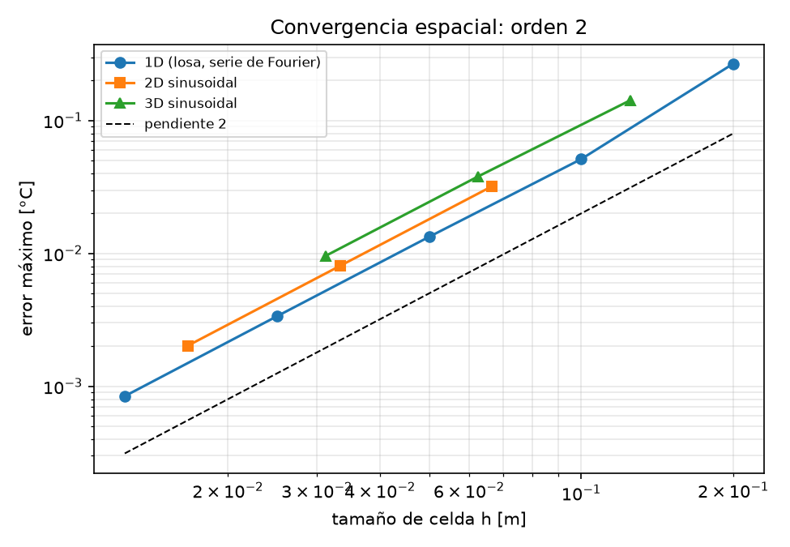
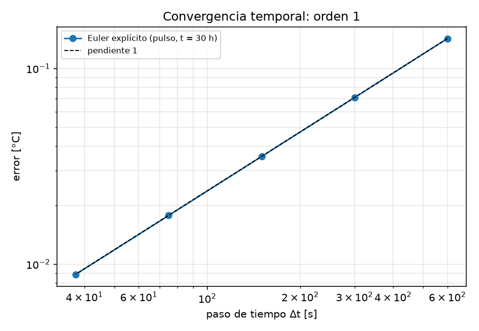

# E06 — Dossier de verificación y BIM del caso base

**Grupo 4** (Trinidad Diaz, Pablo Arancibia, Eduardo Vergara) · Litueche

| | |
|---|---|
| Repositorio | https://github.com/tbdiaz/Proyecto-Hormigon-Masivo |
| Commit evaluado | el SHA declarado en Canvas (este documento está en ese commit) |
| Reproducir | `pip install -r requirements.txt && pip install -e .` · `pytest` (107 tests, ~1,5 min) · `python scripts/dossier_verificacion.py` (figuras de convergencia) |

## 1. Qué se verifica

El solver resuelve $\rho c_p\,\partial T/\partial t = \nabla\cdot(k\nabla T) + Q$ con volúmenes finitos centrados en la celda y Euler
explícito, en 1D (`solver1d.py`) y en 2D/3D (`solver_nd.py`). Cada celda cumple
$C_i\,dT_i/dt = \sum_j G_{ij}(T_j - T_i) + Q_i V_i + q_{borde}$, con conductancias en serie (media armónica de $k$) y caras de
borde a media celda. El paso cumple $\Delta t \le \min_i C_i/\sum G_i$, calculado por `paso_critico_malla` (incluye bordes y materiales).

Verificar es comprobar que el código resuelve bien esas ecuaciones, comparando con soluciones exactas. La validación contra
mediciones de Ju y Lei (2019) es otra etapa.

## 2. Matriz de verificación

| Test | Qué verifica | Error / métrica | Resultado |
|---|---|---|---|
| Losa 1D, serie de Fourier (`test_solver1d`) | stencil 1D + Dirichlet | error máx 8,4e-4 °C con h = 1,25 cm; orden 2,00 | ✅ |
| Sinusoidal 2D (`test_verificacion_nd`) | stencil 2D | 2,0e-3 °C con 60×60; orden 1,99 | ✅ |
| Sinusoidal 3D (`test_verificacion_nd`) | stencil 3D | 9,6e-3 °C con 32³; orden 1,98 | ✅ |
| Convergencia temporal (`scripts/dossier_verificacion.py`) | Euler explícito | orden 1,00 (Δt = 600 → 37,5 s) | ✅ |
| Energía adiabática, 1 y 2 materiales (`test_verificacion_nd`, `test_solver1d`) | conservación, interfaz | error relativo de $\sum \rho c_p V T$: 1,6e-16 | ✅ |
| Fuente uniforme adiabática (`test_verificacion_nd`, `test_solver1d`) | término fuente, unidades W/m³ | T = 153,333333 °C exacto (error 2,8e-14); balance $q_0Vt$: 6e-16 | ✅ |
| Neumann: flujo impuesto y q = 0 (`test_solver_nd`, `test_verificacion_nd`) | signo y magnitud del flujo | energía ganada = $q\,A\,t$ exacta; q = 0 idéntico a adiabático | ✅ |
| Robin estacionario 2D/3D (`test_robin_estacionario_exacto`) | convección + media celda en serie | error 3,8e-13 °C contra $T = 50 - qx/k$ | ✅ |
| Robin transitorio 3D con fuente (`test_bloque`) | Robin + fuente, signo de β | 0,15 °C contra la exacta por modos ($\mu\tan\mu = Bi$); orden 1,9 | ✅ |
| Dos materiales en serie (`test_dos_materiales_...`) | media armónica en la interfaz | error < 1e-8 °C; falla si se usa la media aritmética | ✅ |
| Estabilidad (`test_paso_critico_*`, `test_dt_inestable_*`) | criterio $\Delta t_c$ con bordes | Dirichlet: $h^2/(9\alpha)$ en 3D; rechaza Δt > Δt_c; con `--forzar` diverge | ✅ |
| Hidratación 2D = 1D (`test_hidratacion_2d_igual_al_solver_1d`) | fuente dependiente de T | diferencia 1e-14 °C entre ambos solvers | ✅ |
| Bloque adiabático = ensayo (`test_hidratacion`, `test_rectangulo`) | curva de Ju y Lei con edad equivalente | $T = T_0 + \theta(t_e)$ con error < 0,1 °C | ✅ |
| Lectura del IFC (`test_ifc`) | 5 vertidas, volúmenes, propiedades | volúmenes de la guía con error relativo < 0,5 % | ✅ |

**¿Los tests detectan errores?** Se introdujeron a propósito cuatro errores típicos en una copia del solver: Dirichlet sin la
media celda, Robin sin la media celda, media aritmética en la interfaz y signo de Neumann invertido. **Los cuatro hacen fallar
al menos un test.**

## 3. Convergencia espacial

El paso es automático y proporcional a $h^2$, así que el error total debería bajar como $h^2$.

| | h [m] | error máx [°C] | orden |
|---|---|---|---|
| 1D | 0,2 / 0,1 / 0,05 / 0,025 / 0,0125 | 2,7e-1 / 5,1e-2 / 1,3e-2 / 3,4e-3 / 8,4e-4 | — / 2,39 / 1,94 / 1,99 / 2,00 |
| 2D | 1/15 / 1/30 / 1/60 | 3,2e-2 / 8,1e-3 / 2,0e-3 | — / 1,99 / 1,99 |
| 3D | 1/8 / 1/16 / 1/32 | 1,4e-1 / 3,8e-2 / 9,6e-3 | — / 1,90 / 1,98 |



## 4. Convergencia temporal

El caso es un bloque adiabático con el pulso de calor $Q(t) = Q_{max}/2\,(1-\cos 2\pi t/T)$, con $Q_{max} = 1800$ W/m³ y
$T = 42$ h. El campo queda uniforme, así que **no hay error de malla** y solo se mide el de Euler. La solución exacta es
$T = 20 + \int_0^t Q\,dt/(\rho c_p)$, evaluada a las 30 h.

| Δt [s] | 600 | 300 | 150 | 75 | 37,5 |
|---|---|---|---|---|---|
| error [°C] | 0,142 | 0,071 | 0,035 | 0,018 | 0,009 |
| orden | — | 1,00 | 1,00 | 1,00 | 1,00 |

Euler explícito es de **orden 1 en el tiempo**: atrasa medio paso, $(\Delta t/2)\,Q/(\rho c_p)$. En los cálculos de la fundación se usa
`dt_max = 150 s` por precisión. El estudio de Δt del caso base 1D da Tmax = 78,04 / 77,91 / 77,85 °C con Δt = 600 / 150 / 30 s.



## 5. Conservación de energía, fuente y Robin

- **Energía.** Con todas las caras adiabáticas y sin fuente, $E = \sum \rho c_p V T$ se conserva con error relativo de 1,6e-16
  (precisión de máquina), también con hormigón y suelo juntos (`mcplan energia --dim 3 --dos-materiales`). Se cumple porque
  el flujo que sale de una celda entra igual a su vecina.
- **Fuente.** Con $q_0 = 10\,000$ W/m³ durante 8 h, $T = T_0 + q_0 t/(\rho c_p) = 153{,}333333$ °C sin error, y el campo
  sigue uniforme (`mcplan fuente --dim 3`).
- **Robin** ($-k\,\partial T/\partial n = h(T - T_\infty)$):
  - **Estacionario:** con Dirichlet a 50 °C y aire a 20 °C (h = 10), el perfil coincide con $T = 50 - qx/k$, con
    $q = 30/(L/k + 1/h)$; el error es 3,8e-13 °C.
  - **Transitorio 3D:** con β = h/k = 12,5 1/m, error de 0,15 °C contra la solución exacta por modos. Además, esa exacta
    cumple $\partial T/\partial n = -\beta(T - 20)$ en la cara, con el signo correcto (sale calor si $T > T_\infty$).

## 6. BIM del caso base

`geometry/foundation.ifc` está versionado en el repositorio. Se generó con Blender 5.2.2 + Bonsai 0.9.0, en IFC4 y metros, y
cada vertida es un `IfcFooting` con el property set `UANDES_HormigonMasivo`.


| Vertida | z [m] | Forma | bbox [m] | Volumen [m³] |
|---|---|---|---|---|
| Vertida_01 | 0,00–0,55 | prisma octagonal | 18,00 × 18,00 × 0,55 | 147,63 |
| Vertida_02 | 0,55–1,10 | prisma octagonal | 18,00 × 18,00 × 0,55 | 147,63 |
| Vertida_03 | 1,10–2,20 | tronco octagonal inferior | 18,00 × 18,00 × 1,10 | 214,22 |
| Vertida_04 | 2,20–3,30 | tronco octagonal superior | 12,50 × 12,50 × 1,10 | 88,92 |
| Vertida_05 | 3,30–4,30 | pedestal cilíndrico Ø 7 m (48 lados) | 7,00 × 7,00 × 1,00 | 38,37 |
| **Total** | 0,00–4,30 | | 18,00 × 18,00 × 4,30 | **636,78** |

**Consistencia:** los volúmenes coinciden con la guía del curso (`test_ifc`). La columna del eje leída del IFC por un rayo
vertical (4,30 m) da el mismo resultado que el caso escrito a mano: Tmax = 77,91 °C y ΔT = 58,61 °C (`test_puente_ifc_...`).

**Reproducir el IFC:**

```powershell
blender -b --python scripts/modelar_fundacion_bonsai.py -- geometry/course_geometry.json geometry/foundation.ifc
mcplan ifc-propiedades geometry/foundation.ifc
mcplan ifc-info geometry/foundation.ifc
```

Alternativa sin Blender: `mcplan ifc-crear prueba.ifc`.

### Simplificaciones geométricas

1. Planta octagonal regular de 18 m entre caras, rotada 22,5° para que sus caras queden alineadas con X e Y.
2. Espesor de 1,10 m en el borde y 3,30 m en el centro. La transición se hace con dos troncos iguales, no con la superficie
   cónica continua del proyecto real.
3. Pedestal de Ø 7 m × 1,0 m, adoptado solo para el ejercicio docente. Es un prisma de 48 lados (38,37 m³ contra 38,48 m³ de
   un círculo).
4. Las dos primeras vertidas son losas horizontales de 0,55 m. Las juntas entre vertidas son planos horizontales.
5. Sin armaduras, pernos de anclaje, insertos ni moldajes como sólidos.
6. Centro en (0, 0), base en z = 0 y sin georreferenciación (el sitio de Litueche está en `config/sitio.yaml`).
7. Hormigón homogéneo dentro de cada vertida. El suelo no se modela en el IFC: está en el caso de simulación (5 m a 15 °C).

## 7. Síntesis

El solver 1D/2D/3D converge con **orden 2 en el espacio** y **orden 1 en el tiempo**. **Conserva la energía** a precisión de
máquina y reproduce **exactamente** la fuente uniforme y el estado estacionario con **Robin**. Las condiciones de borde se
verifican también en un caso transitorio 3D con solución exacta. Toda la evidencia se reproduce con `pytest` y
`python scripts/dossier_verificacion.py` sobre el commit declarado, y el IFC está versionado con su script de generación.
