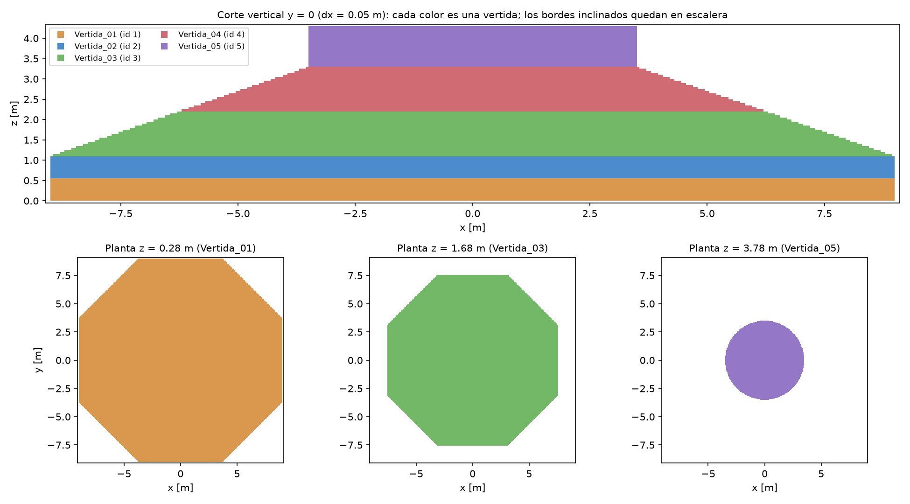
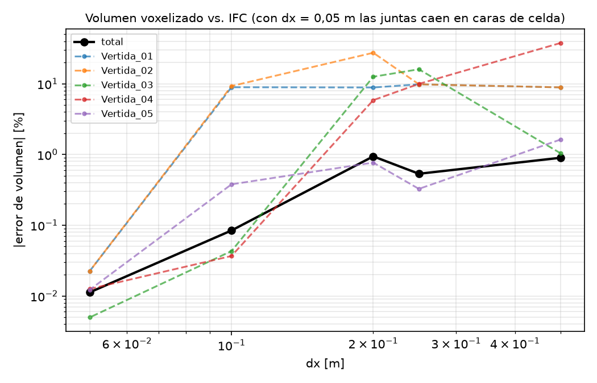

# Voxelización, vertidas e hidratación (E07)

Este documento cubre cómo se pasa del BIM a la grilla térmica y cómo se formula la construcción por vertidas.

Código: [`src/mcplan/voxelizacion.py`](../src/mcplan/voxelizacion.py), con tests en
[`tests/test_voxelizacion.py`](../tests/test_voxelizacion.py). Comando:

```powershell
mcplan voxelizar                       # geometry/foundation.ifc con dx = 0,05 m y estudio de volumen vs dx
mcplan voxelizar --dx 0.1 --estudio 0.5 0.2 0.1
```

## 1. Extracción de la geometría IFC

`ifc_io.leer_vertidas` abre el IFC con IfcOpenShell y toma los elementos cuyo `Name` empieza con `Vertida_`. De cada
uno entrega:

- la geometría **triangulada en coordenadas globales** (`ifcopenshell.geom` con `use-world-coords`, que aplica el
  placement);
- el pset `UANDES_HormigonMasivo`: `VertidaID`, `Inicio_h`, `TemperaturaColocacion_C`, `TipoHormigon`, `Moldaje`,
  `Aislacion` y `RetiroMoldaje_h`.

El volumen exacto de cada malla se calcula con el teorema de la divergencia (`volumen_malla`, suma de tetraedros contra el
origen) y coincide con el que reporta IfcOpenShell.

## 2. Voxelizador: ¿cuándo un vóxel pertenece al sólido?

**Criterio:** un vóxel pertenece a una vertida si **su centro está dentro del sólido**.

**Prueba de pertenencia: regla de paridad.**

- Desde el centro del vóxel se lanza un rayo vertical hacia +z y se cuentan los cruces con la superficie triangulada.
- Un número **impar** de cruces significa que el punto está adentro. Es el teorema de la curva de Jordan, y vale para
  cualquier sólido cerrado, convexo o no (`test_paridad_en_un_solido_no_convexo` lo prueba con una L).
- Los cruces se calculan por columnas: para cada (x, y) se buscan los triángulos cuya proyección en planta contiene el
  punto (coordenadas baricéntricas), y se toma la altura del cruce. Cada centro cuenta cuántos cruces tiene arriba.
- El rayo se corre una fracción ínfima de celda (~1e-7·dx) para que nunca pase justo por una arista ni por una junta
  entre vertidas.

**`vertida_id`.** Es un arreglo entero `(nx, ny, nz)`: 0 para una celda vacía y 1…5 para una vertida. La grilla se alinea
con múltiplos de dx, de modo que la base z = 0 cae en una cara de celda. No hay superposiciones: las juntas entre
vertidas nunca coinciden con un centro.



## 3. Estimación de volumen y error "staircase"

Con el criterio del centro, las caras inclinadas de los troncos quedan **en escalera**. El volumen de cada vertida es
(número de celdas)·dx³ y se compara con el volumen exacto de su malla:

| dx [m] | celdas | V1 | V2 | V3 | V4 | V5 | total |
|---|---|---|---|---|---|---|---|
| 0,50 | 5.140 | −8,9 % | −8,9 % | −1,0 % | +37,8 % | +1,6 % | +0,90 % |
| 0,25 | 40.536 | −9,8 % | −9,8 % | +16,0 % | −10,0 % | +0,3 % | −0,53 % |
| 0,20 | 78.848 | +8,9 % | −27,4 % | +12,6 % | −5,9 % | −0,8 % | −0,94 % |
| 0,10 | 637.312 | −8,9 % | +9,3 % | −0,04 % | −0,04 % | +0,4 % | +0,08 % |
| **0,05** | 5.093.628 | −0,02 % | −0,02 % | +0,00 % | −0,01 % | −0,01 % | **−0,01 %** |



- **Error total.** Baja al refinar la malla (de ~1 % a 0,01 %). En la escalera unos centros quedan adentro y otros
  afuera del borde real, y los errores se compensan en parte. El error en la *posición* de la superficie es de hasta
  dx/2.
- **Error por vertida.** Puede ser grande aunque el total sea chico. Las juntas están a 0,55, 1,10, 2,20 y 3,30 m: si dx no
  divide esas alturas, una **capa entera** de celdas cae en la vertida vecina. Por ejemplo, con dx = 0,1 m la junta a
  0,55 m cae justo en un centro, y V1 pierde 9 % mientras V2 gana 9 %.
- **Regla práctica:** elegir dx divisor de las alturas de junta. dx = 0,05 m las divide todas y deja el error por vertida
  en 0,02 %.
- **Área.** La escalera conserva el área **proyectada**: la base da 268,35 m² contra 268,41 m² del octágono. Pero en una
  cara inclinada de normal n, el área en escalera es (|nx| + |ny| + |nz|) veces la real, y **no converge al refinar**.
  En los troncos, con unos 22° de pendiente, eso es alrededor de 30 % más superficie expuesta. Para la condición Robin
  conviene ponderar cada cara expuesta por el área real.

## 4. Superficies exteriores e interfaces entre vertidas

`caras(vertida_id, activas)` recorre los tres ejes y compara cada celda con su vecina:

| Lado A | Lado B | Tipo | Tratamiento térmico |
|---|---|---|---|
| hormigón activo | vacío o inactivo | **exterior** | condición de borde: Robin (aire) arriba y a los lados; suelo en la base |
| vertida i activa | vertida j activa (i ≠ j) | **interfaz** (junta) | conducción normal, media armónica de k; sin condición de borde |
| hormigón | hormigón (misma vertida) | interior | conducción |

Con dx = 0,05 m:

- **base:** 268,35 m²;
- **laterales:** 217,20 m²;
- **juntas:** V1–V2 268,35 m², V2–V3 264,76 m², V3–V4 127,48 m² y V4–V5 38,37 m² (el círculo del pedestal es 38,48 m²).

Solo se tocan vertidas consecutivas.

## 5. Construcción por vertidas: activación temporal

`PlanVertidas` lee `Inicio_h` y `TemperaturaColocacion_C` de cada vertida (pset del IFC):

| t [h] | se coloca | T colocación | vertidas activas | volumen activo |
|---|---|---|---|---|
| 0 | Vertida_01 | 18 °C | 1 | 147,6 m³ |
| 6 | Vertida_02 | 18 °C | 1, 2 | 295,2 m³ |
| 12 | Vertida_03 | 18 °C | 1–3 | 509,4 m³ |
| 18 | Vertida_04 | 18 °C | 1–4 | 598,3 m³ |
| 24 | Vertida_05 | 18 °C | 1–5 | 636,7 m³ |

- **Antes de su `Inicio_h`**, las celdas de una vertida **no existen** para el solver: no conducen, no generan calor y
  no tienen edad. La cara superior de la última vertida colocada es superficie **exterior** (Robin con el aire).
- **Al activarse** (`PlanVertidas.activar`), sus celdas parten con **T = TemperaturaColocacion_C** y **te = 0**. La cara
  que la separa de la vertida anterior pasa de *exterior* a *interfaz*: el hormigón nuevo, a 18 °C, queda en contacto
  con el anterior, que ya está caliente, y el calor fluye por conducción.
- **Siguiente paso:** el solver 3D sobre la grilla con celdas activas e inactivas. Las conductancias se definen solo
  entre celdas activas, y en las caras activa–inactiva va Robin. Se integra por tramos entre eventos de colocación,
  igual que `simular_serie`.

## 6. Modelo de hidratación

**Generación volumétrica.** $\dot Q_h$ se mide en **W/m³** (J por segundo y por metro cúbico de hormigón). Entra en el
balance de cada vóxel como $\dot Q_h V$ [W].

**De la curva adiabática a la fuente.** En un ensayo adiabático todo el calor queda en la probeta, así que
$\rho c_p\,dT/dt = \dot Q_h$. La curva medida $\theta(t_e)$, que es el aumento adiabático de temperatura, da entonces la
fuente:

$$\dot Q_h = \rho c_p \frac{d\theta}{dt} = \rho c_p\,\frac{d\theta}{dt_e}\,\frac{dt_e}{dt}$$

Con la curva de Ju y Lei (2019) ($\theta \to 60$ °C) y $\rho c_p = 2{,}33$ MJ/(m³K), el máximo de $d\theta/dt_e$ es
2,79 °C/h. Eso equivale a $\dot Q_h \approx 1800$ W/m³ a 20 °C. La energía total, $\rho c_p \cdot 60 \approx 140$ MJ/m³,
es la que eleva la temperatura 60 °C sin pérdidas.

**Efecto de la temperatura (Arrhenius, edad equivalente).**
$dt_e/dt = \exp[E_h/R\,(1/T_{ref} - 1/T)]$, con $E_h/R = 2400$ K y $T_{ref} = 20$ °C:

- a 40 °C el hormigón envejece 1,7 veces más rápido, y a 10 °C, 0,75 veces;
- cada vóxel lleva su propia $t_e$, así que el núcleo caliente hidrata antes que la superficie fría;
- la energía total es la misma: la temperatura cambia el *ritmo*, no el total.

**En el código.** `HidratacionJuLei2019.potencia(te, T, rho, cp)` entrega W/m³. `solver_nd.simular_difusion(...,
hidratacion=, edad=, es_hormigon=)` la aplica solo en las celdas de hormigón y avanza $t_e$ en cada paso. En 2D da lo mismo
que el solver 1D (1e-14 °C), y un bloque adiabático reproduce la curva del ensayo.

**Activación.** Una vertida nueva parte con $t_e = 0$, y desde ahí su $\dot Q_h$ sigue la curva con su propia temperatura.
Con colocaciones cada 6 h, los picos de calor de las vertidas quedan desfasados.
