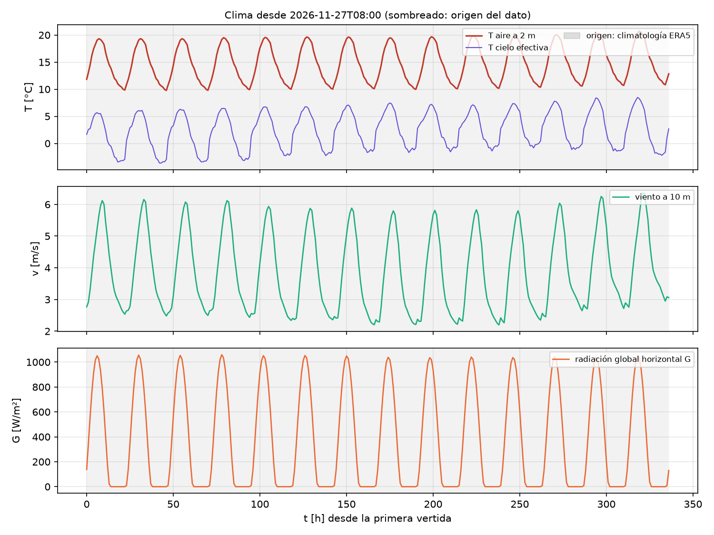
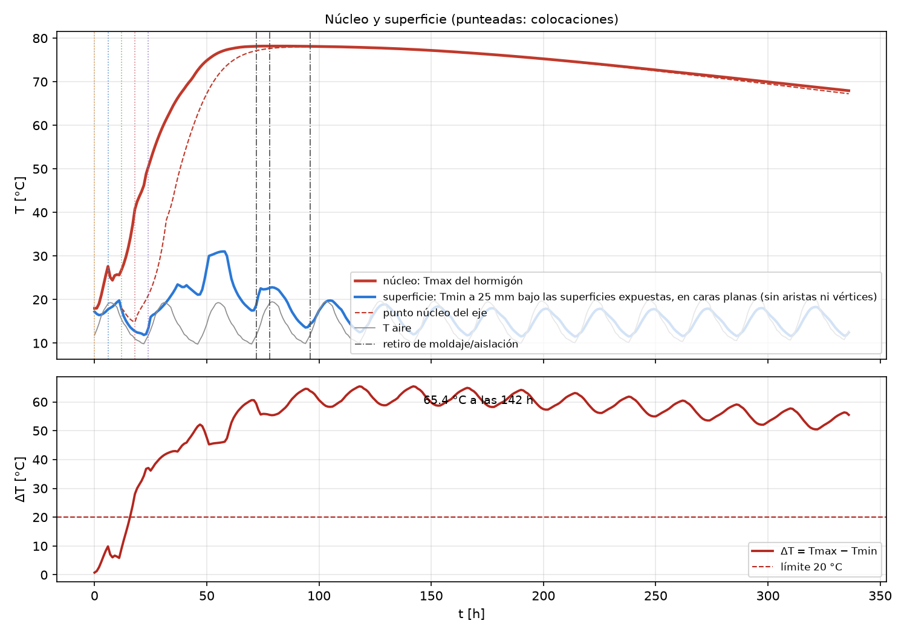
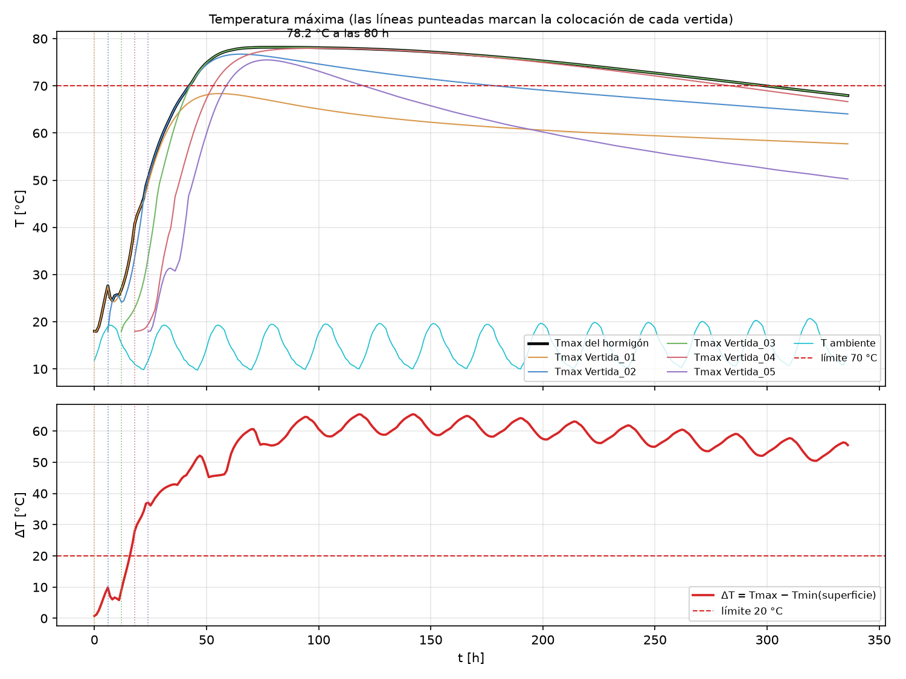
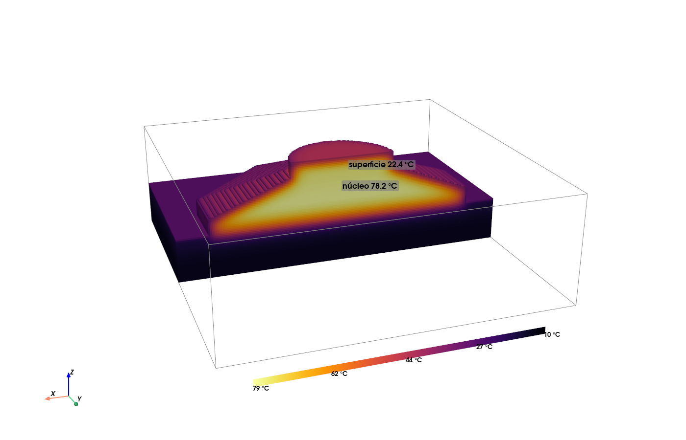
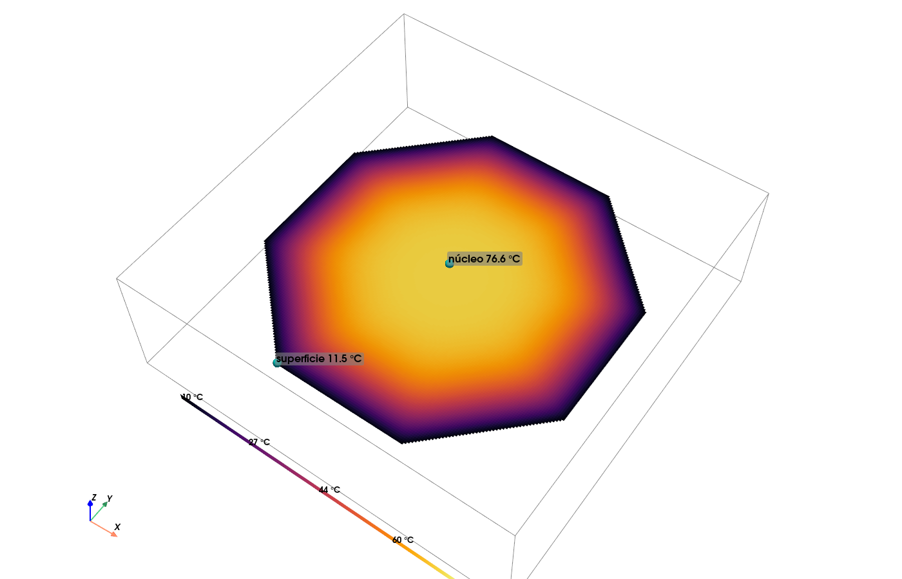
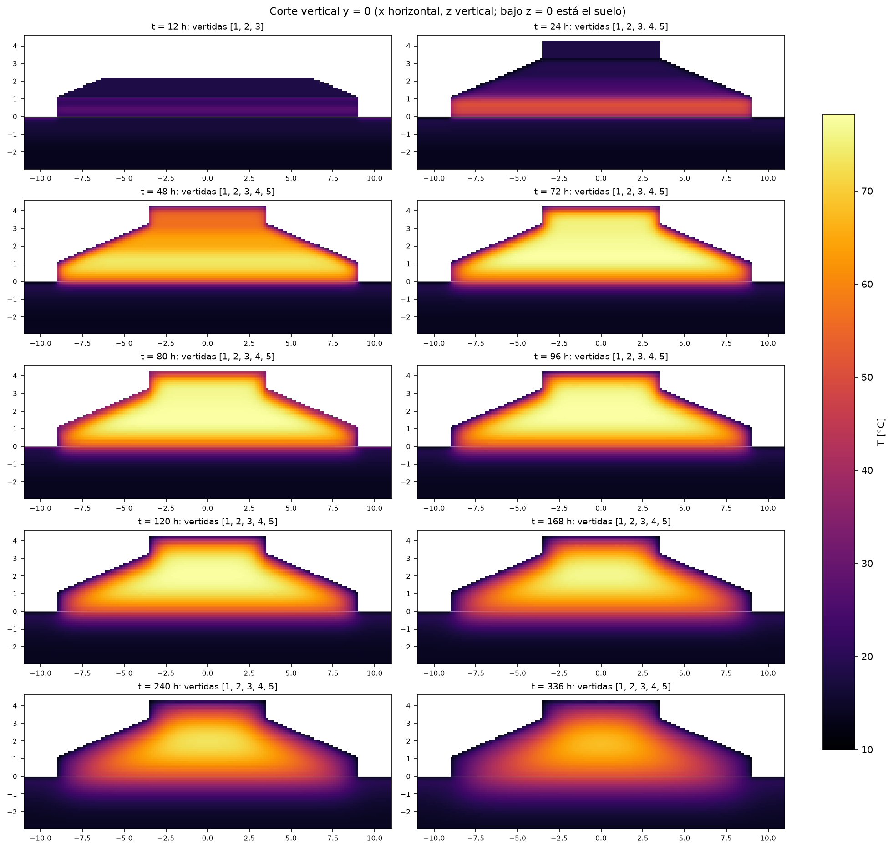

# E12 — Simulación determinista de 14 días (Grupo 4, Litueche)

**Repositorio:** https://github.com/tbdiaz/Proyecto-Hormigon-Masivo · **Commit:** el declarado en Canvas (el que
contiene este archivo).

**Reproducir** (dx = 0,11 m, 2,77 millones de celdas, ~5 min de cálculo):

```powershell
mcplan simular3d config/caso_14d.yaml --vtk
mcplan vtk resultados/caso_14d/vtk --t 80 --recorte y --interactivo
```

Todo el caso está en [`config/caso_14d.yaml`](../config/caso_14d.yaml): geometría del IFC, vertidas, hidratación,
suelo, moldaje y clima. El modelo de bordes y el pipeline de clima están en [ambiente_clima.md](ambiente_clima.md).

## 1. Clima usado y horizonte no cubierto

| | Dataset | Descargado (UTC) | SHA-256 |
|---|---|---|---|
| Pronóstico | `pronostico_ecmwf_ifs025_20261107T1619Z.json`: Open-Meteo, ECMWF IFS 0,25°, del 7 nov 00:00 al 21 nov 23:00 (hora local) | 2026-11-07 16:19 | `61db0a58…` |
| Climatología | `era5_1127_2016-2025_20261107T1619Z.json`: ERA5, 20 nov–18 dic de 2016 a 2025 | 2026-11-07 16:19 | `62d8c318…` |

- **Inicio:** la defensa final es TBD; adoptamos el **27 nov 2026 a las 08:00** (hora local, UTC−3) para la
  Vertida_01.
- **Cobertura:** el pronóstico vigente termina el 21 nov, así que **no cubre ninguna hora** de la ventana
  (27 nov–11 dic).
- **Tratamiento del horizonte:** `clima.ensamblar` usa el pronóstico donde existe. Su anomalía final decae a cero
  en 24 h y el resto se completa con **climatología ERA5**: misma hora del día, ±3 días, 10 años (70 muestras por
  hora). En esta corrida las **337 h son climatología**, y quedan marcadas hora a hora (columna `origen_clima`).
- **Qué conserva y qué pierde:** el ciclo diario se conserva (aire 9,8–20,7 °C, viento 2,2–6,4 m/s, G hasta
  1059 W/m²); los frentes y rachas se suavizan. El pronóstico nuevo entrará solo (`pronostico: ultimo`).



## 2. Condiciones de borde

$q = U(T_{eq} - T)$, $U = 1/(1/h_{ext} + R_{capa} + \Delta x/2k)$; $h_{ext}$ = convección con viento + onda
larga al cielo; el sol ($\alpha G$, α = 0,65) entra en $T_{eq}$ de las caras superiores.

| Superficie | Tipo | Capa | h_ext [W/m²K] | β = h′/k [1/m] | U con dx = 0,11 [W/m²K] |
|---|---|---|---|---|---|
| Hormigón superior (pedestal, escalones de los troncos, cara de la última vertida) | Robin, sol-aire | desnuda | 18,8–35,3 | 8,5–15,9 | 12,8–18,8 |
| Hormigón lateral V1, V2, V5 hasta 72 h después de colocar | Robin | terciado 18 mm, R = 0,15 m²K/W | 18,9–35,5 | 2,2–2,5 | 4,4–4,9 |
| Hormigón lateral desnudo (troncos; V1, V2, V5 tras el desmolde) | Robin | — | 18,9–35,5 | 8,5–16,0 | 12,9–18,9 |
| Suelo al aire (z = 0) | Robin, sol-aire | — | 18,8–35,3 | 13,5–25,4 | 10,8–14,7 |
| Fondo del suelo (z = −3 m) | Dirichlet | — | — | ∞ | 13,9 °C (ERA5, capa 100–255 cm) |
| Costados del suelo | Neumann | — | 0 | 0 | adiabático |
| Hormigón–suelo y juntas entre vertidas | conducción | — | — | — | media armónica de k |

El suelo parte con el perfil climatológico de ERA5: 13,5 / 16,6 / 17,2 / 13,5 °C a 0,04 / 0,18 / 0,64 / 1,78 m.

## 3. Plan de vertidas actual

| Vertida | z [m] | V IFC [m³] | Error vóxeles | Inicio | T colocación | Moldaje lateral |
|---|---|---|---|---|---|---|
| V1 | 0–0,55 | 147,6 | +0,04 % | 0 h (27 nov 08:00) | 18 °C | terciado, retiro a 72 h |
| V2 | 0,55–1,10 | 147,6 | +0,04 % | 6 h | 18 °C | terciado, retiro a 78 h |
| V3 (tronco) | 1,10–2,20 | 214,2 | +0,21 % | 12 h | 18 °C | cara inclinada libre |
| V4 (tronco) | 2,20–3,30 | 88,9 | +0,29 % | 18 h | 18 °C | cara inclinada libre |
| V5 (pedestal) | 3,30–4,30 | 38,4 | −1,11 % | 24 h | 18 °C | terciado, retiro a 96 h |

Sin aislación: el pset del IFC dice `Aislacion = TBD`. El error de volumen total es +0,06 %.

## 4. Resultados

**Criterio ΔT.**
$\Delta T = T_{max} - T_{min}$, con $T_{min}$ a **25 mm bajo las superficies expuestas** (perfil lineal en la
media celda) en caras planas; las aristas, que la escalera exagera, se informan aparte. Límite: 20 °C.

| | Valor | Instante | Ubicación |
|---|---|---|---|
| **Tmax** | **78,2 °C** | **80 h** (30 nov, 16:00) | eje, z = 1,60 m (V3), centro de la masa |
| **ΔTmax** | **65,4 °C** | **142 h** (3 dic, 06:00) | Tmax = 77,4 °C en el eje (z = 2,15 m); Tmin = 12,0 °C a 25 mm bajo el escalón horizontal al pie del tronco, en el borde del octágono (−8,86; −3,69; 1,07) m |
| ΔTmax con aristas | 67,3 °C | 118 h | vértice del octágono en la misma junta V2–V3 |
| Tmax > 70 °C | 257 h | 43 h → 299 h | núcleo |
| ΔT > 20 °C | desde las 16 h | hasta el final | |

ΔTmax ocurre **a las 06:00**: la cara horizontal irradia al cielo despejado ($T_{cielo}$ ≈ −2 °C) y queda bajo
el aire (≈ 10 °C).





**Puntos de control:**

| Punto | Máximo | Instante | A 14 días |
|---|---|---|---|
| Núcleo del eje (z = 2,15) | 78,0 °C | 98 h | 67,3 °C |
| Borde junto al moldaje (x = 8,5; z = 0,65) | 63,0 °C | 44 h | 22,4 °C |
| Bajo el techo del pedestal (z = 4,25) | 44,6 °C | 56 h | 19,9 °C |
| Bajo la cara inclinada de V4 | 52,2 °C | 59 h | 25,9 °C |
| Suelo, 0,5 m bajo la base | 39,0 °C | 336 h (sube) | — |

**Visualización 3D** (`mcplan vtk` o ParaView con `vtk/fundacion.pvd`): núcleo de 78 °C, cascarón frío de ~1 m y
suelo calentándose.







## 5. Sensibilidad rápida (dx = 0,275 m, 30 s cada una)

| Variante | Tmax [°C] | ΔTmax [°C] | Superficie que manda |
|---|---|---|---|
| Plan base | 78,2 | 63,6 | escalón horizontal al pie del tronco (noche despejada) |
| Sin moldaje | 78,2 | 63,7 | la misma |
| Desmolde a 168 h | 78,2 | 62,5 | la misma |
| Manta 5 cm en caras superiores, 14 días | 78,2 | 63,7 | cara lateral de V2 ya desmoldada |
| Colocación a 10 °C | 70,7 | 56,6 | escalón |
| Manta superior 14 d + 10 °C | 70,3 | 56,3 | lateral de V2 |
| Manta en todas las caras 14 d + moldaje 14 d + 10 °C | 70,3 | 37,2 (334 h) | lateral de V2 junto al suelo |

## 6. Conclusión

**El plan actual no cumple determinísticamente.**
- **Tmax:** 78,2 °C contra el límite de 70 °C, durante 257 h.
- **ΔTmax:** 65,4 °C contra 20 °C, desde las 16 h hasta el final.

**Qué mecanismo controla el resultado:**
- **Tmax lo controla el calor de hidratación en una masa gruesa.**
  - El núcleo se comporta casi como el ensayo adiabático: 18 °C de colocación más ~60 °C de θ(te).
  - Sube a 17 °C/día y baja a 1,1 °C/día.
  - El moldaje, el viento y el clima casi no lo tocan (±0,1 °C en la sensibilidad).
  - Sólo la temperatura de colocación lo mueve: −8 °C de colocación bajan Tmax 7,5 °C. Falta todavía 0,3 °C para
    cumplir.
- **ΔT lo controla la pérdida de calor por la superficie más expuesta**, frente a un núcleo que no se enfría.
  - De noche, la onda larga hacia el cielo despejado deja la cara a 25 mm bajo la temperatura del aire.
  - Cubrir una cara sólo traslada Tmin a la siguiente superficie desnuda: sin moldaje, desmolde tardío o manta
    superior dan 62–64 °C.
  - Incluso cubriendo todo durante 14 días y colocando a 10 °C, ΔT queda en 37 °C. La aislación retiene el calor
    del núcleo, y el borde junto al suelo frío pasa a ser la referencia.

**Comparación con Ju y Lei (Fundación 1, sin control):**
- **Núcleo:** el paper midió ~73 °C a ~4 días; el modelo da 78 °C a 3,3–4 días.
- **Sensor superior:** el paper midió ~44 °C; nuestro punto bajo el techo del pedestal llega a 44,6 °C.
- **ΔT:** el paper midió 35 °C. Nuestro criterio usa la superficie expuesta más fría del cuerpo completo, a 25 mm,
  y no un sensor puntual en el techo. Entre el núcleo y ese mismo punto del pedestal hay 54 °C.

**Próximo paso:** $P(\Delta T_{max} > 20\,°C)$ con clima estocástico o ensemble, y medidas combinadas: colocación
más fría, más intervalo entre vertidas, aislación completa con retiro gradual o enfriamiento interno.

**Limitaciones:** sol sólo en caras horizontales, viento a 10 m sin corrección, capas sin capacidad térmica,
escalera de vóxeles en los troncos, suelo homogéneo, Euler con dt = 600 s (~0,2 °C en Tmax).
